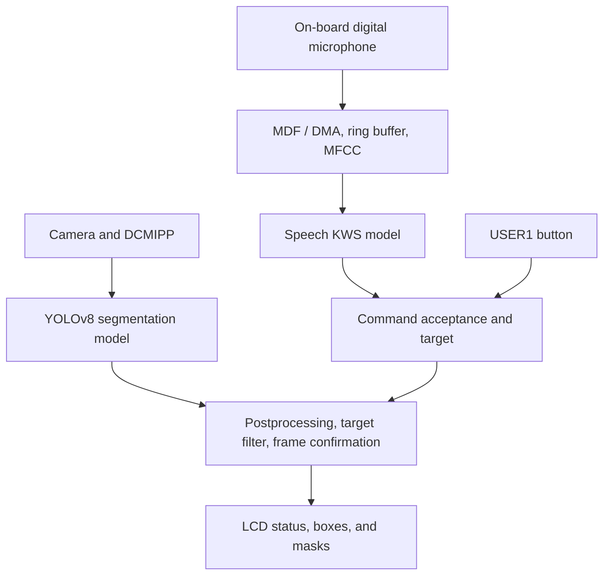

# STM32N6 Dual-Model Voice Object Finder

[繁體中文](README.md) | [English](README.en.md)

**Technologies: Embedded AI · C / Python · FreeRTOS tasks · NPU · Neural-ART · Keyword Spotting (KWS) · YOLOv8 Instance Segmentation · INT8 Quantization · MFCC · CMSIS-DSP · MDF / GPDMA · Cache Coherence · DCMIPP / LCD · UART / CRC32 · GDB · Linker Scripts · Model Memory Pools · Weight/Command Partitioning · Toolchain Version Alignment · Firmware Deployment.**

An end-to-end dual-model system built on the **STM32N6570-DK**, from requirements, models, and dataset preparation through firmware integration, debugging, and deployment. Say `cup`, `bottle`, or `phone` to select a target with a custom-trained speech model. A continuously running YOLOv8 instance-segmentation model searches for that object, while the LCD displays search status, bounding boxes, and masks. The USER1 button also changes the target.

The project adapts ST's hand dual-model example as its FreeRTOS firmware base, regenerates N6 code for ST's prequantized YOLOv8 model, pairs its runtime, and ports postprocessing before building a custom five-class speech dataset and KWS model. Its engineering focus is integrating **data, two models, audio and camera peripherals, a shared NPU, memory, and application state** into one MCU firmware system.

**Recorded results:** **224/227 (98.68%)** across five INT8 development-validation folds; **15/16 (93.75%)** for both float and INT8 evaluation of the final model on 16 held-out clips; and **6/6 voice commands correctly accepted** in the final board session. Earlier fixed samples covering all five classes and four live windows also underwent board/PC numerical comparisons. These comparisons and command-acceptance records each have a specific version and test scope. [Results and version scope](docs/results.en.md)

## Engineering focus: dual-model memory layout and deployment

**Hosting both models requires coordinated application link addresses, model workspaces, weights, and execution commands.** This project aligns the hand-example base with the YOLO memory requirements, reserves a dedicated KWS region, and manages CPU/DMA/NPU caches and data lifetimes.

| Runtime purpose | Location and reserved capacity | Recorded allocation |
| --- | --- | --- |
| Application, FreeRTOS, drivers, and CPU control code for both models | Internal SRAM, starting at `0x34000400`, **1,023 KiB** | Final linked usage **535,544 B**; the region ends at `0x34100000`, before the vision workspace |
| YOLO activations and input/output tensors | Internal SRAM/NPU RAM model pools, plus the external RAM pool starting at `0x90000000` | Allocated by vision code generation and tracked separately from application-linker totals |
| Camera, LCD, postprocessing, and mask snapshots | External PSRAM, starting at `0x91000000`, **15.75 MiB** | Linked-section usage **8,949,920 B**; the region ends at the KWS reservation |
| KWS activations and input/output tensors | External PSRAM, starting at `0x91FC0000`, **256 KiB** | Generated allocation **17,440 B**, accessed through absolute addresses |

| Nonvolatile content | External Flash location | Allocation role |
| --- | --- | --- |
| Packaged application boot image | `0x70100000` | Storage address; the application is linked for execution in the internal SRAM listed above |
| YOLO weights | `0x70380000` | Actual image boundaries are checked against KWS; the recorded vision weight image is **3,474,865 B** |
| KWS weights | `0x70700000`, **64 KiB** reserved | Generated weight allocation **11,409 B** |
| YOLO epoch-controller commands (EC blob) | `0x71380000`, **2 MiB** reserved | Separate command-section usage **230,528 B** |

**Implemented allocation changes:** reduce application SRAM from 1,535 to 1,023 KiB; reserve the final 256 KiB of the 16 MiB PSRAM window for KWS; extract application and vision commands separately from one ELF to avoid binary expansion across address gaps. KWS control code is linked into the application, without a separate KWS EC blob.

Reserved capacity, linked usage, and generated allocation are distinct measurements. The linker reports 0 B for KWS because generated code uses absolute addresses. The upstream vision Flash pool capacity is also not the actual weight-image length: this version checks the recorded image boundary against KWS, and regenerated models require another boundary check. **[Full address map, allocation responsibilities, and image boundaries](docs/memory-deployment.en.md)** provides the details and evidence.

## Official-example and toolchain compatibility work

This project integrates two official examples and regenerates models with ST Edge AI 4.0.1. The following version alignment and image-packaging changes are tied to the official commits used during development.

| Official source and baseline | Project integration change | Recorded outcome |
| --- | --- | --- |
| ST instance-segmentation example `42f7d645…`: README specifies **ST Edge AI 4.0.0**, Makefile links **Runtime1200**, and the generation script invokes `stedgeai` from the system path | Generate with **4.0.1**, pair **Runtime1201**, and update headers, libraries, and NPU support sources together | Vision generation, reference-project linking, and migration into the application completed |
| ST hand dual-model example `6c313001…`: README specifies **3.0.0** and the GCC build links **Runtime1100** | Align the application base to **Runtime1201**, shared by YOLO and KWS | Integrated dual-model GCC build completed |
| The ST segmentation CubeIDE `ModelZoo` configuration defines vision-command/postprocessing sections, while the standalone Makefile omits those definitions | Add Flash/PSRAM section macros to the application Makefile and extract application and vision commands separately | Commands and large postprocessing buffers occupy their intended regions without binary expansion across address gaps |
| The same ST segmentation commit documents **`--align` for CubeProgrammer 2.21 or later**, while its Makefile packaging rule omits alignment | Add alignment in the project packaging flow; verify the payload offset changes from **`0x240` to `0x400`** with identical program content | Subsequent final-version records confirm successful application/KWS-weight verification and six correct board voice acceptances with corresponding targets |

Runtime pairing is a cross-version integration task; packaging has a specific README/Makefile discrepancy within the same upstream commit. **[Official source files, build commands, changes, and success records](docs/toolchain-compatibility.en.md)** documents both and identifies the GCC build path actually used.

## How the system works



**Vision runs continuously; voice changes the search target.** KWS and YOLO use the NPU sequentially within one inference task. Two other FreeRTOS tasks handle display and image signal processing (ISP). Audio DMA keeps collecting samples while inference takes the latest one-second window.

## From initial requirements to board deployment

| Stage | Work completed in this project | Code and records |
| --- | --- | --- |
| 1. Requirements and firmware base | Three object commands and two non-command classes; adapt ST examples for camera, display, FreeRTOS, and the NPU runtime | [Startup](firmware/Src/main.c), [integrated application](firmware/Src/app.c) |
| 2. Visual object-finding path | Regenerate the ST quantized model, pair runtime versions, and port postprocessing/build lists; central-square crop, target filtering, and masks | [Generation and migration history](docs/original-history-review.en.md), [camera configuration](firmware/Src/app_cam.c), [postprocessing interface](firmware/Lib/ai-postprocessing-wrapper/app_postprocess_iseg_yolo_v8_ui.c) |
| 3. Speech-data workflow | Enable recorder UART and driver links, launch from RAM with GDB, receive and check integrity; labeled collection, segmentation, and source-recording groups | [Collection](kws/collect_n6.py), [dataset preparation](kws/prepare_dataset.py), [recording tools](kws/recording_tools/README.en.md) |
| 4. KWS development and training | MFCC, depthwise-separable convolutions, augmentation, class weights, live-data iteration, grouped five-fold validation, and INT8 export | [Training history](kws/training_history/README.en.md), [final sources](kws/training_snapshot/README.en.md) |
| 5. Second-model deployment | Separate network name, STAI context, and RAM/Flash regions; ST Edge AI generation and linking alongside vision | [Generation settings and command](kws/deployment/README.en.md), [KWS build fragment](firmware/mks/kws.mk) |
| 6. Continuous audio and frontend port | MDF/circular DMA, caches, and ring buffer; port Python features to C and check the quantized interface | [finder_mic.c](firmware/Src/finder_mic.c), [finder_kws.c](firmware/Src/finder_kws.c) |
| 7. Layered debugging and data iteration | Correct CPU/NPU cache-maintenance ordering; compare fixed features, fixed PCM, and live windows, investigate the silence error, and add live data | [Comparison code](firmware/Src/finder_kws.c), [debugging history](docs/original-history-review.en.md), [comparison records](docs/evidence/development-history/README.en.md) |
| 8. System integration | Sequential NPU sharing, voice acceptance state machine, target generations, mask snapshots, display coordination, and button control | [app.c](firmware/Src/app.c), [architecture](docs/architecture.en.md) |
| 9. Build, flash, and freeze | Memory/image partitioning, versions and hashes, application/KWS-weight write verification, training snapshot, and IDE source synchronization | [Linker script](firmware/Gcc/STM32N657xx.ld), [deployment records](docs/evidence/development-history/README.en.md), [IDE tool](tools/ide/README.en.md) |

The [development workflow](docs/engineering-workflow.en.md) explains the steps; the [implementation map](docs/development-coverage.en.md) links each stage to code and evidence.

## Deploying two models on N6

| Item | Speech model | Vision model |
| --- | --- | --- |
| Source | Small depthwise-separable convolutional model built and trained for this project | ST's prequantized YOLOv8 instance-segmentation model |
| Input | One-second PCM converted to `49×13×1 INT8` MFCC | `256×256 RGB UINT8` |
| Output | Five classes: `cup`, `bottle`, `phone`, `unknown`, `silence` | `116×1344` detection data and `64×64×32` mask prototypes, both INT8 |
| Deployment path | Keras training / SavedModel → INT8 TFLite → internal ST Edge AI ONNX/quantization information → Neural-ART code generation | ST prequantized TFLite → regenerate with ST Edge AI 4.0.1 → pair the runtime → migrate into application firmware |
| Application integration | C frontend, scale/zero-point checks, command acceptance, and target selection | Official postprocessing, target-class filtering, consecutive-frame confirmation, and coordinate mapping |

The vision path started with pinned official sources and a model baseline in this project's `vision/` directory. Running `generate-n6-model_STM32N6570-DK.sh` completed N6 generation, the reference-project build, and image packaging. The generated model, STAI interface, weights, and execution commands were then moved into `firmware/`, with the following compatibility and allocation work:

| Migration item | Implementation |
| --- | --- |
| Generated code and runtime pairing | Replace runtime 1200 with 1201 in the vision reference project, and 1100 with 1201 in the hand-example base; replace headers, libraries, and NPU support sources together and link `NetworkRuntime1201_CM55_GCC.a` |
| Model and postprocessing replacement | Port ST's postprocessing core and wrapper, revise model/postprocessing build lists, and select the YOLOv8 instance-segmentation interface; configure 80 classes, 1,344 candidate boxes, and 32 mask prototypes of 64×64 |
| Command and buffer allocation | Collect the vision-command input section `.flash_blob` into the Flash output section `.flash_section`, and postprocessing buffers `.psram_bss` into PSRAM's `.psram_section (NOLOAD)`; extract the application and vision commands separately from the ELF |

The [original development history](docs/original-history-review.en.md) records this migration and successful reports at each stage. Vision uses ST's prequantized weights; the model trained and quantized in this project is the KWS described below.

The [original KWS compiler log](docs/evidence/development-history/codegen_20261008/codegen.log) retains internal ONNX conversion and the Neural-ART invocation. The final configuration has **11 NPU hardware stages and 1 CPU Softmax stage**, allocating **11,409 bytes** for weights and **17,440 bytes** for activations. It does not generate a separate KWS epoch-controller command blob (EC blob).

The two models have separate network interfaces and contexts, sharing a runtime initialized once. The vision model is pinned in [sources.txt](sources.txt); the KWS version is traced through its [model hash and generation settings](kws/deployment/README.en.md).

## Recording-data workflow and continuous audio input

The data-collection subsystem adapts the official MDF recorder for PC transfer: enable board serial support (BSP COM) and HAL UART, add two UART driver sources to the IDE links, and retain input from the digital microphone through the multifunction digital filter (MDF). Initial recording-monitor changes added block counts, minimum/maximum values, and peak-to-peak amplitude, followed by a standalone five-second recorder.

The recorder captures five seconds into RAM before sending it to the PC. DMA half/full callbacks skip warm-up blocks and copy samples; the main loop handles timeout, errors, recording length, and CRC32.

The host launcher checks image size, initial stack pointer, and entry vector, loads RAM and configures core state through GDB, and confirms startup with `main`/`MicLine` breakpoints. The receiver handles exclusive serial access, nonblocking reads, deadlines, handshakes, exact length, a trailer, and CRC32 before saving a complete WAV. The labeled collection tool supports resuming after interruption and retains source and session metadata.

For the dual-model system, capture runs continuously:

- **Shared clocks and permissions:** preserve the existing PLL2 and configure only the microphone IC8 divider; configure PE2/PE8 and MDF/DMA access attributes.
- **DMA and caches:** align circular-list descriptors and sample buffers to 64 and 32 bytes respectively. Callbacks maintain cache coherence and publish ring-buffer positions with a memory barrier.
- **Sliding-window consistency:** nominal 16 kHz sampling and a 32,768-sample ring buffer. Each 16,000-sample window becomes eligible after at least 3,200 new samples (nominally about 200 ms); the actual interval depends on DMA block delivery and task scheduling. Handle ring wraparound and discard a snapshot if copying is delayed long enough for data to be overwritten.

Code: [Standalone recorder and upstream diff](kws/recording_firmware/README.en.md) · [RAM launcher and receiver](kws/recording_tools/README.en.md) · [Continuous capture module](firmware/Src/finder_mic.c)

## Dataset engineering and KWS training evolution

The dataset contains five classes: `cup`, `bottle`, `phone`, `unknown`, and `silence`. Short-time energy locates utterances; neighboring-word boundaries constrain segmentation, and clips are padded to one second. Original recordings are grouped before segmentation so related clips from the same source remain in one group.

The initial collection contained 47 five-second recordings, segmented into 142 training and 49 validation clips; recording counts and segment counts are kept distinct. Training evolved from initial offline validation through live-data retraining to the final grouped cross-validation version. Saved implementations include the initial version, live-data versions 2 and 3, and the grouped final version. No separate completion output is available for version 3; actual training results are listed by version in the training history linked below.

- **Features and network:** 49×13×1 MFCC input, a depthwise-separable convolutional network, class weights, and INT8 export.
- **Live-data improvements:** add board-captured speech and background noise; apply gain, noise, and time shifts, limiting shifts by utterance boundaries to avoid cutting off words.
- **Leakage prevention:** identify identical PCM by hash and merge source groups; reject conflicting labels and development/holdout overlap. Each fold derives normalization and background noise only from its training partition.
- **Traceable evaluation:** check class coverage and group separation in each fold, use five-fold validation to select the training duration, and train the final model for 66 epochs. A separate live collection manifest records usage and hashes for 48 clips: 32 for training and 16 held out.

Code: [Segmentation and grouping](kws/prepare_dataset.py) · [MFCC and model](kws/training_snapshot/train_kws.py) · [Grouped validation and quantization](kws/training_snapshot/train_kws_groupcv.py) · [Version history](kws/training_history/README.en.md)

## Python/C numerical comparisons and fault localization

The board uses a CMSIS-DSP floating-point FFT, followed by Mel filtering, logarithms, and DCT, then normalization, clipping, and INT8 quantization. The port handles the real FFT's special DC/Nyquist storage layout and checks shapes, types, scales, and zero points at compile time and initialization. Static FFT and feature workspaces are used by a single inference task.

Debugging has three layers: **test the model with fixed INT8 inputs → test the full C frontend with identical PCM → return live PCM, features, and outputs for PC recomputation.**

Cache handoffs follow where computation actually runs: clean and invalidate old NPU cache contents before updating the KWS input, then clean CPU cache after writing the features. The final Softmax runs on the CPU, so its output is read directly. These are cache-maintenance and investigation steps in the port; the numerical comparisons below separately check the correspondence of inputs, frontend features, and inference outputs.

| Comparison on 2026-10-07 | Results and purpose |
| --- | --- |
| Fixed samples for all five classes, each using direct features (INPUT) and raw audio (PCM) | One sample per class and ten comparison rows; every prediction matched the PC. All 637 INT8 features per PCM sample matched exactly. On both paths, four classes had zero output difference, while silence had a maximum difference of one quantized integer unit |
| Four live windows returned for PC recomputation | INT8 features matched exactly for silence, cup, bottle, and phone; maximum output integer differences were 0, 0, 3, and 1 respectively |

The fixed-sample comparison checks deployment and frontend consistency. Five samples are not ten independent tests or a measure of the final model's generalization accuracy. [Comparison process and versions](docs/original-history-review.en.md)

One silent window was classified as `phone` on all three paths: the board, PC inference from features, and the complete PC frontend. This localized that case to model/data behavior and supported later live-data iteration. The failed case and final-model results are retained separately.

Early offline validation already reached 48/49, but after retraining with four live recordings, a labeled six-command session still accepted only two commands. Per-window scores, score margins, hit counts, and clipping statistics were added, followed by expanded live data and grouped five-fold epoch selection. This led to the final holdout evaluation and the 6/6 board command-acceptance record reported above.

Code: [Frontend, inference, and comparison tools](firmware/Src/finder_kws.c) · [Frontend coefficients](firmware/Inc/finder_kws_tables.h) · [Original comparisons and results](docs/results.en.md)

## FreeRTOS tasks and shared-resource integration

On the Cortex-M55, inference, display, and image signal processing (ISP) run as three cooperating tasks. **Vision runs continuously; voice changes the search target. KWS and YOLO use the NPU sequentially within one inference task.**

| Engineering problem | Implementation |
| --- | --- |
| Camera callbacks acquire free buffers from an interrupt | Distinguish interrupt and task contexts; use `xSemaphoreTakeFromISR` and `portYIELD_FROM_ISR` in the interrupt path, retaining the ordinary semaphore interface in task context |
| Camera capture and inference share data | Copy the camera buffer into the model input and complete cache maintenance before returning the camera buffer, separating capture and inference data lifetimes |
| CPU/DMA/NPU may see different data | Maintain CPU cache after DMA reception; handle old NPU cache contents before the CPU writes new model input, then clean CPU cache after writing, with alignment and memory barriers |
| Target changes during inference | Check a target-generation number, discard stale results, and restart consecutive-hit accumulation |
| Postprocessing overwrites a mask being displayed | Copy model output into a result snapshot; the display task takes its own drawing snapshot under a mutex and draws outside the lock |
| Camera crop and LCD coordinates differ | Take a central square from the display field of view as the 256×256 model input, then map boxes and masks back to the corresponding LCD region |
| Repeated or unstable voice acceptance | Combine amplitude, score, score margin, two consecutive windows, a minimum interval, and re-arming after quiet windows |
| Transient bounding-box changes | Select the highest-confidence result of the target class and require two consecutive frames with box intersection over union (IoU) of at least 0.30 before displaying FOUND |
| Voice path returns a runtime error | Disable voice and display an error while retaining vision and USER1 selection paths; the button uses rising-edge detection and a 200 ms debounce interval |

The system reuses the startup, static-task, and camera framework from ST's dual-model hand example, adapting it to audio/vision models and the data/state handoffs above. Voice-error isolation describes the code design; it has not received a separate fault-injection test and does not cover initialization assertion failures.

Code: [Inference, display, and state machines](firmware/Src/app.c) · [Camera crop](firmware/Src/app_cam.c) · [CPU/NPU cache ordering](firmware/Src/finder_kws.c)

## Build and engineering delivery

From a complete project root containing the matching generated models, weights, runtime, and SDK, the existing build entry point is:

```bash
bash firmware/STM32CubeIDE/STM32N6570-DK/cubeide_make.sh \
  build_finder_ide/Project.elf \
  build_finder_ide/Project.bin \
  build_finder_ide/vision_commands.bin
```

The entry point checks GCC 14.3.1, supports `GCC_PATH`, and invokes Make using project-relative paths. It produces the application ELF, unpackaged application binary, and separate vision commands. Image packaging and programming follow the [build guide](docs/build.en.md) and [deployment layout](docs/memory-deployment.en.md).

The full deployment set contains five images: **FSBL, application, vision weights, KWS weights, and vision commands**. FSBL uses addresses embedded in its HEX file; the other images have assigned locations. Sources, model versions, and image hashes are retained. The final update records verify the application and KWS-weight writes; the other images retain their existing contents.

The IDE source-sync tool checks links, previews changes, backs up files, detects hash races, and replaces configuration atomically. A [vision-generation source and configuration entry](vision/deployment/README.en.md) now complements the existing [KWS deployment configuration](kws/deployment/README.en.md), making both deployment paths traceable.

Code: [Linker script](firmware/Gcc/STM32N657xx.ld) · [Makefile](firmware/Makefile) · [KWS build](firmware/mks/kws.mk) · [IDE synchronization](tools/ide/README.en.md) · [Deployment evidence](docs/evidence/development-history/README.en.md)

## Recorded results and scope

| Item | Result | Evidence and interpretation |
| --- | --- | --- |
| Five-fold KWS INT8 development validation | **224/227, 98.68%** | [Cross-validation report](docs/evidence/kws-groupcv.json); used for development and epoch selection |
| Final-model held-out audio | **15/16, 93.75% for both float and INT8** | [Holdout report](docs/evidence/kws-int8-holdout.json); identical single-window classifications on 16 clips, with one cup classified as phone |
| Earlier fixed-sample deployment comparison | **All five classes correct on INPUT/PCM; zero PCM-feature differences** | [Comparison history](docs/original-history-review.en.md); one sample per class, with a maximum output difference of one quantized integer unit on both paths |
| Earlier live deployment consistency | **Zero INT8 input-feature differences in all four cases** | [Comparison record](docs/evidence/development-history/live_comparison_20261007.json); used to diagnose numerical and porting issues |
| Final-version on-board voice record | **6/6 correct acceptances: two each for cup, bottle, and phone** | [Operation log](docs/evidence/development-history/voice_groupcv_20261008.log); the selected target matched each accepted command; the subsequent five acceptances changed the target class. All 53 vision lines in that session had `found=0` |
| Earlier vision integration in this project | CUP and PHONE produced `found=1` | [Vision log](docs/evidence/development-history/finder_vision_20261004.log); a different version from the final voice session |

The demonstration video is pending. Standalone power and cold boot of this dual-model version have not been listed as experimentally verified. [Full results and version mapping](docs/results.en.md)

## Documentation, build, and sources

- [Dual-model memory and deployment](docs/memory-deployment.en.md): RAM/Flash addresses, sections, model pools, image boundaries, and cache handoffs.
- [Official-toolchain compatibility](docs/toolchain-compatibility.en.md): pinned upstream versions, original settings, integration changes, and deployment evidence.
- [Work and evidence from setup to freeze](docs/development-coverage.en.md): implementation index covering this project’s requirements, data, models, integration, and deployment.
- [Original development history](docs/original-history-review.en.md): vision generation and framework migration, recorder startup, fixed-sample comparisons, and debugging iterations.
- [Code tour](docs/code-tour.en.md) and [architecture](docs/architecture.en.md): functions, execution flow, and configuration.
- [Engineering workflow](docs/engineering-workflow.en.md) and [original evidence](docs/evidence/development-history/README.en.md): model, data, deployment, and measurement records.
- [Build and external dependencies](docs/build.en.md): GCC 14.3.1, ST Edge AI 4.0.1, Neural-ART 1.1.3-275, CubeIDE 2.2.0, and dependencies.
- [Publication inventory](docs/publication-review.en.md) and [third-party sources](THIRD_PARTY_NOTICES.en.md): retained materials and licensing.

The public repository provides application and training sources, configurations, patches, and engineering evidence. Model weights, generated model code, raw audio, and prebuilt images are not included; a complete build requires the matching dependencies. HAL, BSP, CMSIS-DSP, FreeRTOS, the ST inference runtime, and vision postprocessing retain their upstream attribution. This project's data, training, adaptation, integration, debugging, and validation work is described above.
