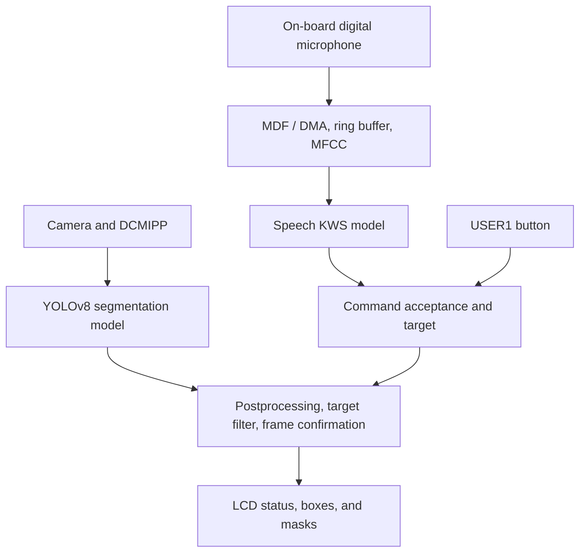

# STM32N6 Dual-Model Voice Object Finder

[繁體中文](README.md) | [English](README.en.md)

**Technologies: Embedded AI · C / Python · FreeRTOS tasks · NPU · Neural-ART · Keyword Spotting (KWS) · YOLOv8 Instance Segmentation · INT8 Quantization · MFCC · CMSIS-DSP · MDF / GPDMA · Cache Coherence · DCMIPP / LCD · UART / CRC32 · GDB · Linker Scripts · Model Memory Pools · Weight/Command Partitioning · Toolchain Version Alignment · Firmware Deployment.**

<h1 align="center">Hardware Demonstration</h1>

<p align="center">
  <a href="https://youtu.be/m7wET9g5u6k">
    
  </a>
</p>

<p align="center">
  <a href="https://youtu.be/m7wET9g5u6k"><strong>▶ Watch the full hardware demonstration</strong></a>
</p>

This project implements an embedded voice-and-vision object finder on the **STM32N6570-DK**, covering requirements, on-board recording, dataset preparation, model training, dual-model firmware, real-time operation, and deployment debugging. Say `cup`, `bottle`, or `phone` to select a search target with the custom-trained speech model. A continuously running YOLOv8 instance-segmentation model processes camera images, while the LCD displays search status, bounding boxes, and masks. The USER1 button also changes the target.

**The work includes building a five-class speech dataset, designing, training, and quantizing a keyword-spotting (KWS) model, and completing N6 code generation and integrated deployment for both YOLOv8 and KWS.** At the model/hardware boundary, it ports the Python speech frontend to C and establishes element-wise PC/board numerical comparisons; allocates RAM, Flash, weights, and execution commands for both models; and implements shared-NPU scheduling, CPU/DMA/NPU cache handoffs, and image, target-state, and display-data coordination across FreeRTOS tasks. Development also covers diagnosing live recognition errors, collecting additional data and retraining, and locating and correcting startup, image-packaging, and toolchain-compatibility issues.

## Engineering work implemented in this project

| Area | Concrete implementation | Code and records |
| --- | --- | --- |
| Speech data and model development | Build a five-class dataset with segmentation and source grouping; design a depthwise-separable convolutional model with augmentation, leakage checks, grouped five-fold validation, and INT8 quantization | [Dataset preparation](kws/prepare_dataset.py), [final training and quantization](kws/training_snapshot/README.en.md) |
| On-board audio and numerical porting | Build RAM-launch and UART/CRC32 recording tools; integrate continuous MDF/DMA capture, a ring buffer, and overwrite-aware snapshots; port the speech frontend to C and compare all 637 features | [Recording tools](kws/recording_tools/README.en.md), [continuous capture](firmware/Src/finder_mic.c), [frontend and comparisons](firmware/Src/finder_kws.c) |
| Vision conversion and deployment | Run N6 code generation for YOLOv8, pair Runtime1201, port the postprocessing interface and build lists, and implement center cropping, target filtering, coordinate mapping, and mask display | [Generation workflow](vision/deployment/README.en.md), [deployment and porting steps](docs/engineering-workflow.en.md) |
| Dual-model memory layout | Adjust application SRAM boundaries, reserve KWS RAM/Flash, allocate vision-command and postprocessing sections, check weight boundaries, and split images | [Memory and deployment](docs/memory-deployment.en.md), [linker script](firmware/Gcc/STM32N657xx.ld) |
| Real-time system and application state | Schedule both models sequentially on one NPU; correct camera interrupt semaphore handling and maintain cache coherence; coordinate inference/display through target generations, mask snapshots, and a voice-acceptance state machine | [Integrated application](firmware/Src/app.c), [architecture](docs/architecture.en.md) |
| Fault localization and delivery | Compare fixed features, fixed audio, and live windows in layers; iterate data and models from live results; align code generation/runtime versions, correct packaging offsets, and complete builds and board deployment | [Debugging and iteration history](docs/original-history-review.en.md), [toolchain and packaging changes](docs/toolchain-compatibility.en.md) |

**Recorded results:** **224/227 (98.68%)** across five INT8 development-validation folds; **15/16 (93.75%)** for both float and INT8 evaluation of the final model on 16 held-out clips; and **6/6 voice commands correctly accepted** in the final board session. Earlier fixed samples covering all five classes and four live windows also underwent board/PC numerical comparisons. These comparisons and command-acceptance records each have a specific version and test scope. [Results and version scope](docs/results.en.md)

## Engineering focus: dual-model memory layout and deployment

**Hosting both models requires coordinated application link addresses, model workspaces, weights, and execution commands.** This project reconfigures the application and YOLO memory boundaries, reserves a dedicated KWS region, and manages CPU/DMA/NPU caches and data lifetimes.

| Runtime purpose | Location and reserved capacity | Recorded allocation |
| --- | --- | --- |
| Application, FreeRTOS, drivers, and CPU control code for both models | Internal SRAM, starting at `0x34000400`, **1,023 KiB** | Final linked usage **535,544 B**; the region ends at `0x34100000`, before the vision workspace |
| YOLO activations and input/output tensors | Internal SRAM/NPU RAM model pools, plus the external RAM pool starting at `0x90000000` | Allocated by vision code generation and tracked separately from application-linker totals |
| Camera, LCD, postprocessing, and mask snapshots | External PSRAM, starting at `0x91000000`, **15.75 MiB** | Linked-section usage **8,949,920 B**; the region ends at the KWS reservation |
| KWS activations and input/output tensors | External PSRAM, starting at `0x91FC0000`, **256 KiB** | Generated allocation **17,440 B**, accessed through absolute addresses |

| Nonvolatile content | External Flash location | Allocation role |
| --- | --- | --- |
| Packaged application boot image | `0x70100000` | Storage address; the application is linked for execution in the internal SRAM listed above |
| YOLO weights | `0x70380000` | Actual image boundaries are checked against KWS; the recorded vision weight image is **3,474,865 B** |
| KWS weights | `0x70700000`, **64 KiB** reserved | Generated weight allocation **11,409 B** |
| YOLO epoch-controller commands (EC blob) | `0x71380000`, **2 MiB** reserved | Separate command-section usage **230,528 B** |

**Implemented allocation changes:** reduce application SRAM from 1,535 to 1,023 KiB; reserve the final 256 KiB of the 16 MiB PSRAM window for KWS; extract application and vision commands separately from one ELF to avoid binary expansion across address gaps. KWS control code is linked into the application, without a separate KWS EC blob.

Reserved capacity, linked usage, and generated allocation are distinct measurements. The linker reports 0 B for KWS because generated code uses absolute addresses. The upstream vision Flash pool capacity is also not the actual weight-image length: this version checks the recorded image boundary against KWS, and regenerated models require another boundary check. **[Full address map, allocation responsibilities, and image boundaries](docs/memory-deployment.en.md)** provides the details and evidence.

## Complete development route: 32 steps

The route starts with requirements and vision deployment, builds the speech dataset and model, and continues through real-time integration, numerical debugging, live-data iteration, and delivery. All 32 steps below identify the implementation and its code entry points. Each step title opens its problem, approach, artifacts, and results.

| Phase | Steps | Outcome |
| --- | --- | --- |
| [Requirements and project versions](#route-foundation) | 01–02 | Define operation and establish the project with version provenance |
| [Vision model and object finding](#route-vision) | 03–11 | YOLO N6 generation, runtime pairing, camera/postprocessing, display, and memory integration |
| [Speech data and KWS development](#route-kws) | 12–17 | Recording, grouping, features, model training, INT8 quantization, and second-model generation |
| [Continuous audio and dual-model coordination](#route-runtime) | 18–21 | Circular DMA, C frontend, caches, shared NPU, and cross-task state |
| [Deployment debugging and live improvements](#route-debugging) | 22–25 | Image alignment, layered comparisons, misclassification diagnosis, and command acceptance |
| [Final training and board deployment](#route-finalization) | 26–30 | Expanded live data, grouped validation, holdout evaluation, artifact synchronization, and voice operation |
| [Engineering delivery and demonstration](#route-delivery) | 31–32 | IDE synchronization, Git/publication preparation, and demonstration video |

<a id="route-foundation"></a>

### 01–02 | Requirements and project versions

| Step | Work completed | Direct code, configuration, or record |
| --- | --- | --- |
| [01 Define functions and operation](docs/development-steps.en.md#step-01) | Voice selects cup, bottle, or phone; vision searches continuously, the LCD displays status and masks, and USER1 provides manual selection. | [Target selection and operation](firmware/Src/app.c) |
| [02 Establish the project and pin versions](docs/development-steps.en.md#step-02) | Organize application firmware, the vision reference, and KWS development; pin model, source commits, and tool versions with provenance records. | [Vision-project setup source](tools/development-history/vision_01_prepare_vision.sh), [Source versions](docs/source-provenance.json), [model record](sources.txt), [build entry](firmware/Makefile) |

<a id="route-vision"></a>

### 03–11 | Vision model and object finding

| Step | Work completed | Direct code, configuration, or record |
| --- | --- | --- |
| [03 Run YOLO conversion and N6 generation](docs/development-steps.en.md#step-03) | Run ST Edge AI 4.0.1 generation in this project, producing the N6 network, STAI interface, weights, and execution commands, then build the reference application. | [Project generation/build source](tools/development-history/vision_03_generate_and_build_vision.sh), [Reference generation script](vision/deployment/upstream-reference/generate-n6-model_STM32N6570-DK.sh), [Neural-ART configuration](vision/deployment/upstream-reference/user_neuralart_STM32N6570-DK.json) |
| [04 Pair model runtimes](docs/development-steps.en.md#step-04) | Align Runtime1200 in the vision reference and Runtime1100 in the application base to Runtime1201, updating headers, libraries, and NPU support together. | [Reference runtime pairing](tools/development-history/vision_02_match_vision_runtime.py), [Application runtime pairing](tools/development-history/vision_06_match_main_runtime.py), [Runtime linking](firmware/mks/ai.mk), [version differences and changes](docs/toolchain-compatibility.en.md) |
| [05 Replace the hand models with YOLO](docs/development-steps.en.md#step-05) | Replace generated model sources and build lists, and connect the YOLO network context, inputs/outputs, and startup interface. | [Six-artifact migration](tools/development-history/vision_05_copy_vision_artifacts.sh), [Model build replacement](tools/development-history/vision_07_update_model_build_list.py), [Model build list](firmware/mks/ai.mk), [initialization and inference](firmware/Src/app.c), [startup](firmware/Src/main.c) |
| [06 Configure DCMIPP crop and input](docs/development-steps.en.md#step-06) | Take a central square from the LCD field of view, scale it to a 256×256 RGB model input, and retain the display pipeline. | [DCMIPP_PipeInitNn](firmware/Src/app_cam.c) |
| [07 Port the postprocessing core and adapter](docs/development-steps.en.md#step-07) | Connect detection decoding and mask generation; configure 80 classes, 1,344 candidate boxes, and 32 mask prototypes of 64×64. | [Postprocessing migration source](tools/development-history/vision_08_import_postprocessing.py), [Postprocessing adapter](firmware/Lib/ai-postprocessing-wrapper/app_postprocess_iseg_yolo_v8_ui.c), [application configuration](firmware/Inc/app_config.h) |
| [08 Implement target filtering and frame confirmation](docs/development-steps.en.md#step-08) | Select the highest-confidence detection of the target class and require two consecutive frames with box intersection over union (IoU) of at least 0.30 before reporting FOUND. | [box_iou and target filtering](firmware/Src/app.c) |
| [09 Integrate LCD boxes, masks, and snapshots](docs/development-steps.en.md#step-09) | Map boxes and masks into display coordinates; separate result and drawing snapshots and render outside the lock to prevent postprocessing from overwriting display data. | [Display_NetworkOutput and display task](firmware/Src/app.c) |
| [10 Correct camera interrupts and buffer handoffs](docs/development-steps.en.md#step-10) | Use interrupt-specific semaphore operations and required task switching; copy model input and complete cache maintenance before returning camera buffers. | [Application/interrupt integration source](tools/development-history/vision_12_integrate_vision_application.py), [Camera queue and nn_thread_fct](firmware/Src/app.c) |
| [11 Allocate vision memory and image sections](docs/development-steps.en.md#step-11) | Adjust the application SRAM boundary, allocate Flash commands and PSRAM postprocessing buffers, and extract the application and vision commands separately from the ELF. | [Camera/memory change source](tools/development-history/vision_13_configure_camera_and_memory.py), [Linker script](firmware/Gcc/STM32N657xx.ld), [section extraction rules](firmware/Makefile) |

<a id="route-kws"></a>

### 12–17 | Speech data and KWS development

| Step | Work completed | Direct code, configuration, or record |
| --- | --- | --- |
| [12 Build the five-class recording dataset](docs/development-steps.en.md#step-12) | Collect 47 five-second recordings: 12 for each command, 8 unknown, and 3 silence; use GDB RAM startup, UART, and CRC32 for board recording. | [Labeled collection](kws/collect_n6.py), [RAM launcher](kws/recording_tools/n6_mic_start_and_record.sh), [receiver](kws/recording_tools/n6_receive_wav.py) |
| [13 Segment and group original recordings](docs/development-steps.en.md#step-13) | Use short-time energy and neighboring-utterance boundaries to create one-second clips: 142 training and 49 validation, keeping clips from each original recording in one group. | [speech_regions and extract_word](kws/prepare_dataset.py) |
| [14 Build the Python MFCC frontend](docs/development-steps.en.md#step-14) | Implement mean removal, Hann windowing, FFT, Mel filtering, logarithms, DCT, and normalization to produce 49×13 features and export coefficients. | [features and coefficient export](kws/training_snapshot/train_kws.py) |
| [15 Design and train five-class KWS](docs/development-steps.en.md#step-15) | Build a depthwise-separable convolutional network with class weights, gain/noise/time-shift augmentation, model selection, and training records. | [Initial training](kws/training_history/20261005_baseline/train_kws.py), [final model design](kws/training_snapshot/train_kws.py) |
| [16 Export INT8 from SavedModel](docs/development-steps.en.md#step-16) | Calibrate with representative training data, export INT8 TFLite, retain scales, zero points, and frontend coefficients, and compare float/quantized results. | [export_int8](kws/training_snapshot/train_kws_groupcv.py) |
| [17 Generate and link the second model](docs/development-steps.en.md#step-17) | Give KWS its own name, context, and RAM/Flash; complete ST's internal ONNX and Neural-ART generation, with 11 NPU hardware stages and 1 CPU Softmax stage in the final version. | [KWS host generation workflow](tools/development-history/generate_groupcv_model.py), [Memory pool](kws/deployment/kws.mpool), [generation settings](kws/deployment/kws_neuralart.json), [KWS build](firmware/mks/kws.mk) |

<a id="route-runtime"></a>

### 18–21 | Continuous audio and dual-model coordination

| Step | Work completed | Direct code, configuration, or record |
| --- | --- | --- |
| [18 Integrate continuous MDF/GPDMA recording](docs/development-steps.en.md#step-18) | Configure circular DMA, clocks, and access attributes; use a 32,768-sample ring buffer for the latest one-second window, handling warm-up, wraparound, and snapshot overwrite. | [finder_mic_start, receive_block, and finder_mic_take](firmware/Src/finder_mic.c) |
| [19 Port the frontend to C](docs/development-steps.en.md#step-19) | Implement the Python-equivalent feature path with CMSIS-DSP, handle real-FFT DC/Nyquist storage, and produce 637 INT8 features. | [encode_mfcc](firmware/Src/finder_kws.c), [frontend coefficients](firmware/Inc/finder_kws_tables.h) |
| [20 Manage CPU/DMA/NPU caches](docs/development-steps.en.md#step-20) | Maintain CPU cache after DMA capture; handle old NPU/CPU cache contents before model-input updates and clean after writes, with alignment and memory barriers. | [Audio cache handoffs](firmware/Src/finder_mic.c), [kws_begin_input_update and prepare_input_cache](firmware/Src/finder_kws.c) |
| [21 Coordinate models and cross-task state](docs/development-steps.en.md#step-21) | Run both models sequentially on the NPU in one inference task, with display/ISP tasks; reject stale results using target generations and preserve consistency through mask snapshots. | [nn_thread_fct, dp_thread_fct, and finder_select_target](firmware/Src/app.c) |

<a id="route-debugging"></a>

### 22–25 | Deployment debugging and live improvements

| Step | Work completed | Direct code, configuration, or record |
| --- | --- | --- |
| [22 Diagnose builds, startup, and packaging](docs/development-steps.en.md#step-22) | Check build, packaging, programming, and startup separately; correct the payload offset from 0x240 to 0x400 and verify identical program content. | [Payload-offset inspection](tools/development-history/inspect_boot_payload.py), [Alignment-correction source](tools/development-history/realign_and_flash_application.sh), [Build and image extraction](firmware/Makefile), [packaging correction record](docs/original-history-review.en.md) |
| [23 Build three-layer numerical comparisons](docs/development-steps.en.md#step-23) | Test inference with fixed features, the C frontend with fixed PCM, and live windows with PC recomputation. Both paths classify the earlier five fixed cases correctly, with all 637 features per PCM sample matching. | [Fixed-reference export](tools/development-history/export_fixed_reference.py), [Live reception and PC recomputation](tools/development-history/compare_live_windows.py), [finder_kws_compare and live transfer](firmware/Src/finder_kws.c), [fixed reference data](firmware/Inc/finder_kws_compare_data.h) |
| [24 Diagnose live errors and add samples](docs/development-steps.en.md#step-24) | Use board/PC three-path comparisons to investigate silence classified as phone, retrain with live speech/noise, and add per-window scores and capture statistics to investigate missed commands. | [Field-diagnostic recording](tools/development-history/record_voice_diagnostics.py), [Live-data retraining](kws/train_kws.py), [diagnostics and capture](firmware/Src/finder_kws.c), [comparison results](docs/evidence/development-history/live_comparison_20261007.json) |
| [25 Design voice-acceptance rules](docs/development-steps.en.md#step-25) | Combine amplitude, score, margin, two consecutive windows, a minimum interval, and quiet re-arming to turn classifications into stable target-selection events. | [finder_voice_poll](firmware/Src/app.c) |

<a id="route-finalization"></a>

### 26–30 | Final training and board deployment

| Step | Work completed | Direct code, configuration, or record |
| --- | --- | --- |
| [26 Expand live data and the development pool](docs/development-steps.en.md#step-26) | Collect 48 live clips, assigning 32 to training and 16 to holdout; combine the earlier 142+49 clips and 4 live clips with the new training clips for a 227-clip development pool. | [Live-data collection program](tools/development-history/collect_live_dataset.py), [Data loading](kws/training_snapshot/train_kws_groupcv.py), [48-clip manifest](docs/evidence/development-history/live_dataset_manifest_20261008.json) |
| [27 Run leakage-controlled grouped validation and final training](docs/development-steps.en.md#step-27) | Merge source groups by PCM hash, isolate holdout data, and normalize/calibrate within each fold's training set. Five-fold INT8 scores 224/227; retrain for the median best duration of 66 epochs. | [make_splits, make_training, and fit_model](kws/training_snapshot/train_kws_groupcv.py), [five-fold report](docs/evidence/kws-groupcv.json) |
| [28 Evaluate holdout and synchronize final artifacts](docs/development-steps.en.md#step-28) | Float and INT8 both score 15/16 on 16 held-out clips; synchronize the model, coefficients, quantization scales/zero points, and diagnostic switches, and freeze their versions. | [Final installation/build source](tools/development-history/install_build_groupcv.py), [Export and evaluation](kws/training_snapshot/train_kws_groupcv.py), [quantized-interface checks](firmware/Src/finder_kws.c), [holdout report](docs/evidence/kws-int8-holdout.json) |
| [29 Configure five images and program the final update](docs/development-steps.en.md#step-29) | Assign FSBL, application, vision weights, KWS weights, and vision commands, checking addresses/hashes; final records retain verified writes for the application and KWS weights. | [Final programming/verification source](tools/development-history/flash_groupcv.py), [Linker script](firmware/Gcc/STM32N657xx.ld), [final write manifest](docs/evidence/development-history/deployment_20261008/flash_manifest.json), [write verification](docs/evidence/development-history/deployment_20261008/flash_verified.json) |
| [30 Test final-version voice operation](docs/development-steps.en.md#step-30) | Accept cup, bottle, and phone twice each: 6/6 voice commands correctly accepted with matching targets. Voice acceptance and visual object-finding results are recorded separately. | [Final-operation recording](tools/development-history/record_voice_groupcv.py), [Acceptance and target selection](firmware/Src/app.c), [board operation log](docs/evidence/development-history/voice_groupcv_20261008.log) |

<a id="route-delivery"></a>

### 31–32 | Engineering delivery and demonstration

| Step | Work completed | Direct code, configuration, or record |
| --- | --- | --- |
| [31 Prepare IDE, Git, and the public project](docs/development-steps.en.md#step-31) | Synchronize IDE sources/build entry points, retain source versions, commits, and hashes, and organize public sources, dependencies, and licenses. | [IDE synchronization](tools/ide/sync_cubeide_sources.py), [build entry](firmware/STM32CubeIDE/STM32N6570-DK/cubeide_make.sh), [provenance](docs/source-provenance.json) |
| [32 Complete the hardware demonstration video](docs/development-steps.en.md#step-32) | The completed video is featured at the top of the homepage. Standalone power and cold boot have no verified record and remain separate from the video and existing board tests. | [Demonstration video](https://youtu.be/m7wET9g5u6k), [demonstration application](firmware/Src/app.c) |

See the [32-step development guide](docs/development-steps.en.md) for each step's full explanation. The existing [engineering workflow](docs/engineering-workflow.en.md) and [implementation index](docs/development-coverage.en.md) retain their mappings to code, configuration, and results.

## Dual-model code generation, runtime, and image packaging

This project generates code with ST Edge AI 4.0.1 and aligns the runtime, build sections, and image-packaging rules for both models to deploy the generated artifacts as a board application. The table identifies the official versions used during development, their original settings, and the project changes, including the specific alignment discrepancy between the official README and Makefile.

| Official source and baseline | Project integration change | Recorded outcome |
| --- | --- | --- |
| ST instance-segmentation example `42f7d645…`: README specifies **ST Edge AI 4.0.0**, Makefile links **Runtime1200**, and the generation script invokes `stedgeai` from the system path | Generate with **4.0.1**, pair **Runtime1201**, and update headers, libraries, and NPU support sources together | Vision generation, reference-project linking, and migration into the application completed |
| ST hand dual-model example `6c313001…`: README specifies **3.0.0** and the GCC build links **Runtime1100** | Align the application base to **Runtime1201**, shared by YOLO and KWS | Integrated dual-model GCC build completed |
| The ST segmentation CubeIDE `ModelZoo` configuration defines vision-command/postprocessing sections, while the standalone Makefile omits those definitions | Add Flash/PSRAM section macros to the application Makefile and extract application and vision commands separately | Commands and large postprocessing buffers occupy their intended regions without binary expansion across address gaps |
| The same ST segmentation commit documents **`--align` for CubeProgrammer 2.21 or later**, while its Makefile packaging rule omits alignment | Add alignment in the project packaging flow; verify the payload offset changes from **`0x240` to `0x400`** with identical program content | Subsequent final-version records confirm successful application/KWS-weight verification and six correct board voice acceptances with corresponding targets |

Runtime pairing is a cross-version integration task; packaging has a specific README/Makefile discrepancy within the same upstream commit. **[Official source files, build commands, changes, and success records](docs/toolchain-compatibility.en.md)** documents both and identifies the GCC build path actually used.

## How the system works



**Vision runs continuously; voice changes the search target.** KWS and YOLO use the NPU sequentially within one inference task. Two other FreeRTOS tasks handle display and image signal processing (ISP). Audio DMA keeps collecting samples while inference takes the latest one-second window.

## Deploying two models on N6

| Item | Speech model | Vision model |
| --- | --- | --- |
| Model and artifact development | Small depthwise-separable convolutional model designed, trained, and quantized for this project | Generate the N6 network, interfaces, weights, and execution commands in this project from a version-pinned YOLOv8n-seg TFLite input; [input provenance and actual conversion records](vision/deployment/README.en.md) |
| Input | One-second PCM converted to `49×13×1 INT8` MFCC | `256×256 RGB UINT8` |
| Output | Five classes: `cup`, `bottle`, `phone`, `unknown`, `silence` | `116×1344` detection data and `64×64×32` mask prototypes, both INT8 |
| Deployment path | Keras training / SavedModel → INT8 TFLite → internal ST Edge AI ONNX/quantization information → Neural-ART code generation | Quantized TFLite → run ST Edge AI 4.0.1 / Neural-ART generation in this project → pair Runtime1201 → port the model, postprocessing, and build → allocate and deploy images |
| Application integration | C frontend, scale/zero-point checks, command acceptance, and target selection | Postprocessing interface port, target-class filtering, consecutive-frame confirmation, and coordinate mapping |

Vision deployment runs `generate-n6-model_STM32N6570-DK.sh` in this project's `vision/` directory to complete N6 generation, the reference-project build, and image packaging. The generated model, STAI interface, weights, and execution commands are then moved into `firmware/`. Model sources and tool versions are pinned, with the following compatibility and allocation work completed during migration:

| Migration item | Implementation |
| --- | --- |
| Generated code and runtime pairing | Replace runtime 1200 with 1201 in the vision reference project, and 1100 with 1201 in the hand-example base; replace headers, libraries, and NPU support sources together and link `NetworkRuntime1201_CM55_GCC.a` |
| Model and postprocessing replacement | Port ST's postprocessing core and wrapper, revise model/postprocessing build lists, and select the YOLOv8 instance-segmentation interface; configure 80 classes, 1,344 candidate boxes, and 32 mask prototypes of 64×64 |
| Command and buffer allocation | Collect the vision-command input section `.flash_blob` into the Flash output section `.flash_section`, and postprocessing buffers `.psram_bss` into PSRAM's `.psram_section (NOLOAD)`; extract the application and vision commands separately from the ELF |

The [original development history](docs/original-history-review.en.md) records this migration and successful reports for model generation, reference-project builds, application-firmware integration, and board operation.

The [original KWS compiler log](docs/evidence/development-history/codegen_20261008/codegen.log) retains internal ONNX conversion and the Neural-ART invocation. The final configuration has **11 NPU hardware stages and 1 CPU Softmax stage**, allocating **11,409 bytes** for weights and **17,440 bytes** for activations. It does not generate a separate KWS epoch-controller command blob (EC blob).

The two models have separate network interfaces and contexts, sharing a runtime initialized once. The vision model is pinned in [sources.txt](sources.txt); the KWS version is traced through its [model hash and generation settings](kws/deployment/README.en.md).

## Recording-data workflow and continuous audio input

The data-collection subsystem establishes a complete path from the board's digital microphone to a PC dataset: enable board serial support (BSP COM) and HAL UART, add two UART driver sources to the IDE links, and capture audio through the multifunction digital filter (MDF). Using the MDF recording example's peripheral configuration as a base, the implementation adds block counts, minimum/maximum values, and peak-to-peak monitoring, followed by a standalone five-second recording and transfer flow.

The recorder captures five seconds into RAM before sending it to the PC. DMA half/full callbacks skip warm-up blocks and copy samples; the main loop handles timeout, errors, recording length, and CRC32.

The host launcher checks image size, initial stack pointer, and entry vector, loads RAM and configures core state through GDB, and confirms startup with `main`/`MicLine` breakpoints. The receiver handles exclusive serial access, nonblocking reads, deadlines, handshakes, exact length, a trailer, and CRC32 before saving a complete WAV. The labeled collection tool supports resuming after interruption and retains source and session metadata.

For the dual-model system, capture runs continuously:

- **Shared clocks and permissions:** preserve the existing PLL2 and configure only the microphone IC8 divider; configure PE2/PE8 and MDF/DMA access attributes.
- **DMA and caches:** align circular-list descriptors and sample buffers to 64 and 32 bytes respectively. Callbacks maintain cache coherence and publish ring-buffer positions with a memory barrier.
- **Sliding-window consistency:** nominal 16 kHz sampling and a 32,768-sample ring buffer. Each 16,000-sample window becomes eligible after at least 3,200 new samples (nominally about 200 ms); the actual interval depends on DMA block delivery and task scheduling. Handle ring wraparound and discard a snapshot if copying is delayed long enough for data to be overwritten.

Code: [Standalone recorder and upstream diff](kws/recording_firmware/README.en.md) · [RAM launcher and receiver](kws/recording_tools/README.en.md) · [Continuous capture module](firmware/Src/finder_mic.c)

## Dataset engineering and KWS training evolution

The dataset contains five classes: `cup`, `bottle`, `phone`, `unknown`, and `silence`. Short-time energy locates utterances; neighboring-word boundaries constrain segmentation, and clips are padded to one second. Original recordings are grouped before segmentation so related clips from the same source remain in one group.

The initial collection contained 47 five-second recordings, segmented into 142 training and 49 validation clips; recording counts and segment counts are kept distinct. Training evolved from initial offline validation through live-data retraining to the final grouped cross-validation version. The [training history](kws/training_history/README.en.md) records source code, training outputs, and evaluation status for each version.

- **Features and network:** 49×13×1 MFCC input, a depthwise-separable convolutional network, class weights, and INT8 export.
- **Live-data improvements:** add board-captured speech and background noise; apply gain, noise, and time shifts, limiting shifts by utterance boundaries to avoid cutting off words.
- **Leakage prevention:** identify identical PCM by hash and merge source groups; reject conflicting labels and development/holdout overlap. Each fold derives normalization and background noise only from its training partition.
- **Traceable evaluation:** check class coverage and group separation in each fold, use five-fold validation to select the training duration, and train the final model for 66 epochs. A separate live collection manifest records usage and hashes for 48 clips: 32 for training and 16 held out.

Code: [Segmentation and grouping](kws/prepare_dataset.py) · [MFCC and model](kws/training_snapshot/train_kws.py) · [Grouped validation and quantization](kws/training_snapshot/train_kws_groupcv.py) · [Version history](kws/training_history/README.en.md)

## Python/C numerical comparisons and fault localization

The board uses a CMSIS-DSP floating-point FFT, followed by Mel filtering, logarithms, and DCT, then normalization, clipping, and INT8 quantization. The port handles the real FFT's special DC/Nyquist storage layout and checks shapes, types, scales, and zero points at compile time and initialization. Static FFT and feature workspaces are used by a single inference task.

Debugging has three layers: **test the model with fixed INT8 inputs → test the full C frontend with identical PCM → return live PCM, features, and outputs for PC recomputation.**

Cache handoffs follow where computation actually runs: clean and invalidate old NPU cache contents before updating the KWS input, then clean CPU cache after writing the features. The final Softmax runs on the CPU, so its output is read directly. These are cache-maintenance and investigation steps in the port; the numerical comparisons below separately check the correspondence of inputs, frontend features, and inference outputs.

| Comparison on 2026-10-07 | Results and purpose |
| --- | --- |
| Fixed samples for all five classes, each using direct features (INPUT) and raw audio (PCM) | One sample per class and ten comparison rows; every prediction matched the PC. All 637 INT8 features per PCM sample matched exactly. On both paths, four classes had zero output difference, while silence had a maximum difference of one quantized integer unit |
| Four live windows returned for PC recomputation | INT8 features matched exactly for silence, cup, bottle, and phone; maximum output integer differences were 0, 0, 3, and 1 respectively |

One fixed sample per class is evaluated through both paths to check model-deployment and frontend consistency; the final model's classification performance is evaluated separately through grouped validation and held-out audio. See the [comparison process](docs/original-history-review.en.md) for versions and methods.

One silent window was classified as `phone` on all three paths: the board, PC inference from features, and the complete PC frontend. This localized that case to model/data behavior and supported later live-data iteration. The failed case and final-model results are retained separately.

Early offline validation already reached 48/49, but after retraining with four live recordings, a labeled six-command session still accepted only two commands. Per-window scores, score margins, hit counts, and clipping statistics were added, followed by expanded live data and grouped five-fold epoch selection. This led to the final holdout evaluation and the 6/6 board command-acceptance record reported above.

Code: [Frontend, inference, and comparison tools](firmware/Src/finder_kws.c) · [Frontend coefficients](firmware/Inc/finder_kws_tables.h) · [Original comparisons and results](docs/results.en.md)

## FreeRTOS tasks and shared-resource integration

On the Cortex-M55, inference, display, and image signal processing (ISP) run as three cooperating tasks. **Vision runs continuously; voice changes the search target. KWS and YOLO use the NPU sequentially within one inference task.**

| Engineering problem | Implementation |
| --- | --- |
| Camera callbacks acquire free buffers from an interrupt | Distinguish interrupt and task contexts; use `xSemaphoreTakeFromISR` and `portYIELD_FROM_ISR` in the interrupt path, retaining the ordinary semaphore interface in task context |
| Camera capture and inference share data | Copy the camera buffer into the model input and complete cache maintenance before returning the camera buffer, separating capture and inference data lifetimes |
| CPU/DMA/NPU may see different data | Maintain CPU cache after DMA reception; handle old NPU cache contents before the CPU writes new model input, then clean CPU cache after writing, with alignment and memory barriers |
| Target changes during inference | Check a target-generation number, discard stale results, and restart consecutive-hit accumulation |
| Postprocessing overwrites a mask being displayed | Copy model output into a result snapshot; the display task takes its own drawing snapshot under a mutex and draws outside the lock |
| Camera crop and LCD coordinates differ | Take a central square from the display field of view as the 256×256 model input, then map boxes and masks back to the corresponding LCD region |
| Repeated or unstable voice acceptance | Combine amplitude, score, score margin, two consecutive windows, a minimum interval, and re-arming after quiet windows |
| Transient bounding-box changes | Select the highest-confidence result of the target class and require two consecutive frames with box intersection over union (IoU) of at least 0.30 before displaying FOUND |
| Voice path returns a runtime error | Disable voice and display an error while retaining vision and USER1 selection paths; the button uses rising-edge detection and a 200 ms debounce interval |

These implementations coordinate continuous audio, both models, search state, and display data, explicitly handling interrupt context, data ownership, and result validity. The scope and verification status of voice-error handling are documented in the [architecture](docs/architecture.en.md) and [implementation map](docs/development-coverage.en.md).

Code: [Inference, display, and state machines](firmware/Src/app.c) · [Camera crop](firmware/Src/app_cam.c) · [CPU/NPU cache ordering](firmware/Src/finder_kws.c)

## Build and engineering delivery

From a complete project root containing the matching generated models, weights, runtime, and SDK, the existing build entry point is:

```bash
bash firmware/STM32CubeIDE/STM32N6570-DK/cubeide_make.sh \
  build_finder_ide/Project.elf \
  build_finder_ide/Project.bin \
  build_finder_ide/vision_commands.bin
```

The entry point checks GCC 14.3.1, supports `GCC_PATH`, and invokes Make using project-relative paths. It produces the application ELF, unpackaged application binary, and separate vision commands. Image packaging and programming follow the [build guide](docs/build.en.md) and [deployment layout](docs/memory-deployment.en.md).

The full deployment set contains five images: **FSBL, application, vision weights, KWS weights, and vision commands**. FSBL uses addresses embedded in its HEX file; the other images have assigned locations. Sources, model versions, and image hashes are retained. The final update records verify the application and KWS-weight writes; the other images retain their existing contents.

The IDE source-sync tool checks links, previews changes, backs up files, detects hash races, and replaces configuration atomically. A [vision-generation source and configuration entry](vision/deployment/README.en.md) now complements the existing [KWS deployment configuration](kws/deployment/README.en.md), making both deployment paths traceable.

Code: [Linker script](firmware/Gcc/STM32N657xx.ld) · [Makefile](firmware/Makefile) · [KWS build](firmware/mks/kws.mk) · [IDE synchronization](tools/ide/README.en.md) · [Deployment evidence](docs/evidence/development-history/README.en.md)

## Recorded results and scope

| Item | Result | Evidence and interpretation |
| --- | --- | --- |
| Five-fold KWS INT8 development validation | **224/227, 98.68%** | [Cross-validation report](docs/evidence/kws-groupcv.json); used for development and epoch selection |
| Final-model held-out audio | **15/16, 93.75% for both float and INT8** | [Holdout report](docs/evidence/kws-int8-holdout.json); identical single-window classifications on 16 clips, with one cup classified as phone |
| Earlier fixed-sample deployment comparison | **All five classes correct on INPUT/PCM; zero PCM-feature differences** | [Comparison history](docs/original-history-review.en.md); one sample per class, with a maximum output difference of one quantized integer unit on both paths |
| Earlier live deployment consistency | **Zero INT8 input-feature differences in all four cases** | [Comparison record](docs/evidence/development-history/live_comparison_20261007.json); used to diagnose numerical and porting issues |
| Final-version on-board voice record | **6/6 correct acceptances: two each for cup, bottle, and phone** | [Operation log](docs/evidence/development-history/voice_groupcv_20261008.log); the selected target matched each accepted command; the subsequent five acceptances changed the target class. All 53 vision lines in that session had `found=0` |
| Earlier vision integration in this project | CUP and PHONE produced `found=1` | [Vision log](docs/evidence/development-history/finder_vision_20261004.log); a different version from the final voice session |

The [hardware demonstration video](https://youtu.be/m7wET9g5u6k) is available. Standalone power and cold boot of this dual-model version have not been listed as experimentally verified. [Full results and version mapping](docs/results.en.md)

## Documentation, build, and sources

- [Dual-model memory and deployment](docs/memory-deployment.en.md): RAM/Flash addresses, sections, model pools, image boundaries, and cache handoffs.
- [Official-toolchain compatibility](docs/toolchain-compatibility.en.md): pinned upstream versions, original settings, integration changes, and deployment evidence.
- [Work and evidence from setup to freeze](docs/development-coverage.en.md): implementation index covering this project’s requirements, data, models, integration, and deployment.
- [Original development history](docs/original-history-review.en.md): vision generation and framework migration, recorder startup, fixed-sample comparisons, and debugging iterations.
- [Code tour](docs/code-tour.en.md) and [architecture](docs/architecture.en.md): functions, execution flow, and configuration.
- [Engineering workflow](docs/engineering-workflow.en.md) and [original evidence](docs/evidence/development-history/README.en.md): model, data, deployment, and measurement records.
- [Build and external dependencies](docs/build.en.md): GCC 14.3.1, ST Edge AI 4.0.1, Neural-ART 1.1.3-275, CubeIDE 2.2.0, and dependencies.
- [Publication inventory](docs/publication-review.en.md) and [third-party sources](THIRD_PARTY_NOTICES.en.md): retained materials and licensing.

## Model and platform sources

This project builds its speech dataset and implements KWS network design, training, quantization, and board deployment. Vision work covers N6 code generation for YOLOv8, runtime pairing, postprocessing porting, memory/image allocation, and the object-search application. The vision-generation input recorded on 2026-10-04 is pinned to an ST model version; its file hash and this project's artifact handoffs are documented in the [vision conversion records](vision/deployment/README.en.md). Firmware builds on the startup, FreeRTOS tasks, and camera framework from ST's dual-model hand example. HAL, BSP, CMSIS-DSP, the ST inference runtime, and vision decoding, non-maximum suppression (NMS), and mask reconstruction retain their original attribution and licenses. Component versions and the project's modification entry points are documented in [sources and implementation scope](docs/publication-review.en.md).

The public repository provides application and training sources, configurations, patches, and engineering evidence. Model weights, generated model code, raw audio, and prebuilt images are not included; a complete build requires the [matching dependencies](docs/build.en.md).
