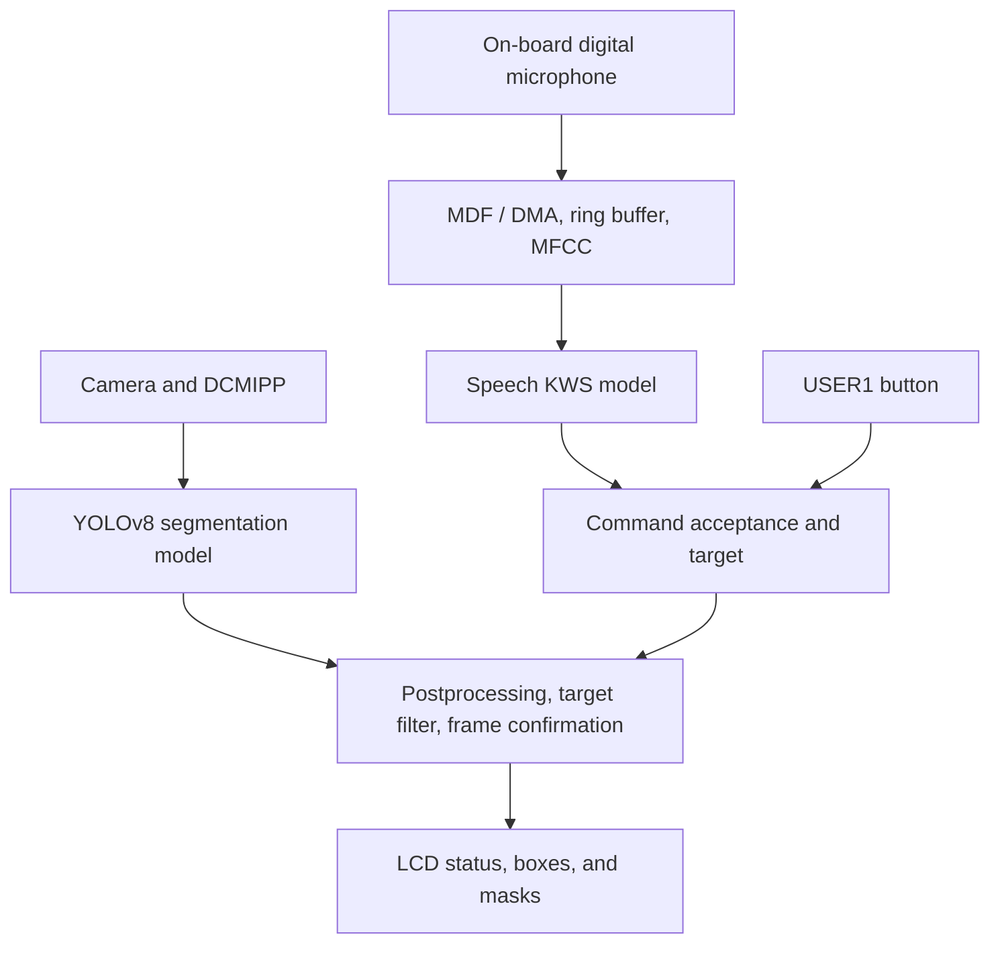

# STM32N6 Dual-Model Voice Object Finder

[繁體中文](README.md) | [English](README.en.md)

**Technologies: Embedded AI · C / Python · FreeRTOS tasks · NPU · Neural-ART · Keyword Spotting (KWS) · YOLOv8 Instance Segmentation · INT8 Quantization · MFCC · CMSIS-DSP · MDF / GPDMA · Cache Coherence · DCMIPP / LCD · UART / CRC32 · GDB · Memory Layout and Firmware Deployment.**

An end-to-end dual-model system built on the **STM32N6570-DK**, from requirements, models, and dataset preparation through firmware integration, debugging, and deployment. Say `cup`, `bottle`, or `phone` to select a target with a custom-trained speech model. A continuously running YOLOv8 instance-segmentation model searches for that object, while the LCD displays search status, bounding boxes, and masks. The USER1 button also changes the target.

The project adapts ST's hand dual-model example as its FreeRTOS firmware base, integrates ST's prequantized YOLOv8 model, and builds a custom five-class speech dataset and KWS model. Its engineering focus is integrating **data, two models, audio and camera peripherals, a shared NPU, memory, and application state** into one MCU firmware system.

**Recorded results:** **224/227 (98.68%)** across five INT8 development-validation folds; **15/16 (93.75%)** for both float and INT8 evaluation of the final model on 16 held-out clips; and identical INT8 features in four earlier board/PC comparisons. [Results and version scope](docs/results.en.md)

## How the system works

**Vision runs continuously; voice changes the search target.** KWS and YOLO use the NPU sequentially within one inference task. Two other FreeRTOS tasks handle display and image signal processing (ISP). Audio DMA keeps collecting samples while inference takes the latest one-second window.

## From initial requirements to board deployment

| Stage | Work completed in this project | Code and records |
| --- | --- | --- |
| 1. Requirements and firmware base | Three object commands and two non-command classes; adapt ST examples for camera, display, FreeRTOS, and the NPU runtime | [Startup](firmware/Src/main.c), [integrated application](firmware/Src/app.c) |
| 2. Visual object-finding path | Integrate the ST quantized model and postprocessing; central-square crop, model-interface checks, class filtering, boxes, and masks | [Camera configuration](firmware/Src/app_cam.c), [postprocessing interface](firmware/Lib/ai-postprocessing-wrapper/app_postprocess_iseg_yolo_v8_ui.c) |
| 3. Speech-data workflow | Connect on-board recording and receiver tools; labeled collection, format checks, provenance, energy-based segmentation, and source-recording groups | [Collection](kws/collect_n6.py), [dataset preparation](kws/prepare_dataset.py), [recording tools](kws/recording_tools/README.en.md) |
| 4. KWS development and training | MFCC, depthwise-separable convolutions, augmentation, class weights, live-data iteration, grouped five-fold validation, and INT8 export | [Training history](kws/training_history/README.en.md), [final sources](kws/training_snapshot/README.en.md) |
| 5. Second-model deployment | Separate network name, STAI context, and RAM/Flash regions; ST Edge AI generation and linking alongside vision | [Generation settings and command](kws/deployment/README.en.md), [KWS build fragment](firmware/mks/kws.mk) |
| 6. Continuous audio and frontend port | MDF/circular DMA, caches, and ring buffer; port Python features to C and check the quantized interface | [finder_mic.c](firmware/Src/finder_mic.c), [finder_kws.c](firmware/Src/finder_kws.c) |
| 7. Layered debugging and data iteration | Compare fixed features, fixed PCM, and live windows; return PCM/features/outputs, investigate the early silence error, and add live data | [Comparison code](firmware/Src/finder_kws.c), [comparison records](docs/evidence/development-history/README.en.md) |
| 8. System integration | Sequential NPU sharing, voice acceptance state machine, target generations, mask snapshots, display coordination, and button control | [app.c](firmware/Src/app.c), [architecture](docs/architecture.en.md) |
| 9. Build, flash, and freeze | Memory/image partitioning, versions and hashes, application/KWS-weight write verification, training snapshot, and IDE source synchronization | [Linker script](firmware/Gcc/STM32N657xx.ld), [deployment records](docs/evidence/development-history/README.en.md), [IDE tool](tools/ide/README.en.md) |

The [development workflow](docs/engineering-workflow.en.md) explains the steps; the [implementation map](docs/development-coverage.en.md) links each stage to code and evidence.

## Deploying two models on N6

| Item | Speech model | Vision model |
| --- | --- | --- |
| Source | Small depthwise-separable convolutional model built and trained for this project | ST's prequantized YOLOv8 instance-segmentation model |
| Input | One-second PCM converted to `49×13×1 INT8` MFCC | `256×256 RGB UINT8` |
| Output | Five classes: `cup`, `bottle`, `phone`, `unknown`, `silence` | `116×1344` detection data and `64×64×32` mask prototypes, both INT8 |
| Deployment path | Keras training / SavedModel → INT8 TFLite → internal ST Edge AI ONNX/quantization information → Neural-ART code generation | Integrate the ST quantized TFLite and its matching N6 generated code/runtime into the application |
| Application integration | C frontend, scale/zero-point checks, command acceptance, and target selection | Official postprocessing, target-class filtering, consecutive-frame confirmation, and coordinate mapping |

The [original KWS compiler log](docs/evidence/development-history/codegen_20261008/codegen.log) retains internal ONNX conversion and the Neural-ART invocation. The final configuration has **11 NPU hardware stages and 1 CPU Softmax stage**, allocating **11,409 bytes** for weights and **17,440 bytes** for activations. It does not generate a separate KWS epoch-controller command blob (EC blob).

The two models have separate network interfaces and contexts, sharing a runtime initialized once. The vision model is pinned in [sources.txt](sources.txt); the KWS version is traced through its [model hash and generation settings](kws/deployment/README.en.md).

## Recording-data workflow and continuous audio input

The data-collection workflow incorporates a standalone recorder adapted from the official MDF example, capturing five seconds into RAM before sending it to the PC. DMA half/full callbacks skip warm-up blocks and copy samples; the main loop handles timeout, errors, recording length, and CRC32. Audio comes from the board's digital microphone through the multifunction digital filter (MDF).

The host launcher checks image size, initial stack pointer, and entry vector, then confirms startup through RAM loading and breakpoints. The receiver handles exclusive serial access, nonblocking reads, deadlines, handshakes, exact length, a trailer, and CRC32 before saving a complete WAV. The labeled collection tool supports resuming after interruption and retains source and session metadata.

For the dual-model system, capture runs continuously:

- **Shared clocks and permissions:** preserve the existing PLL2 and configure only the microphone IC8 divider; configure PE2/PE8 and MDF/DMA access attributes.
- **DMA and caches:** align circular-list descriptors and sample buffers to 64 and 32 bytes respectively. Callbacks maintain cache coherence and publish ring-buffer positions with a memory barrier.
- **Sliding-window consistency:** nominal 16 kHz sampling and a 32,768-sample ring buffer. Each 16,000-sample window becomes eligible after at least 3,200 new samples (nominally about 200 ms); the actual interval depends on DMA block delivery and task scheduling. Handle ring wraparound and discard a snapshot if copying is delayed long enough for data to be overwritten.

Code: [Standalone recorder and upstream diff](kws/recording_firmware/README.en.md) · [RAM launcher and receiver](kws/recording_tools/README.en.md) · [Continuous capture module](firmware/Src/finder_mic.c)

## Dataset engineering and KWS training evolution

The dataset contains five classes: `cup`, `bottle`, `phone`, `unknown`, and `silence`. Short-time energy locates utterances; neighboring-word boundaries constrain segmentation, and clips are padded to one second. Original recordings are grouped before segmentation so related clips from the same source remain in one group.

Training evolved from the initial version through live-data versions 2 and 3 to the final grouped cross-validation version:

- **Features and network:** 49×13×1 MFCC input, a depthwise-separable convolutional network, class weights, and INT8 export.
- **Live-data improvements:** add board-captured speech and background noise; apply gain, noise, and time shifts, limiting shifts by utterance boundaries to avoid cutting off words.
- **Leakage prevention:** identify identical PCM by hash and merge source groups; reject conflicting labels and development/holdout overlap. Each fold derives normalization and background noise only from its training partition.
- **Traceable evaluation:** check class coverage and group separation in each fold, select the final training duration through five-fold validation, and retrain. A separate live collection manifest records usage and hashes for 48 clips: 32 for training and 16 held out.

Code: [Segmentation and grouping](kws/prepare_dataset.py) · [MFCC and model](kws/training_snapshot/train_kws.py) · [Grouped validation and quantization](kws/training_snapshot/train_kws_groupcv.py) · [Version history](kws/training_history/README.en.md)

## Python/C numerical comparisons and fault localization

The board uses a CMSIS-DSP floating-point FFT, followed by Mel filtering, logarithms, and DCT, then normalization, clipping, and INT8 quantization. The port handles the real FFT's special DC/Nyquist storage layout and checks shapes, types, scales, and zero points at compile time and initialization. Static FFT and feature workspaces are used by a single inference task.

Debugging has three layers: **test the model with fixed INT8 inputs → test the full C frontend with identical PCM → return live PCM, features, and outputs for PC recomputation.** In four earlier live windows, board and PC INT8 features matched exactly; maximum output integer differences were 0, 0, 3, and 1 respectively.

One silent window was classified as `phone` on all three paths: the board, PC inference from features, and the complete PC frontend. This localized that case to model/data behavior and supported later live-data iteration. The failed case and final-model results are retained separately.

Code: [Frontend, inference, and comparison tools](firmware/Src/finder_kws.c) · [Frontend coefficients](firmware/Inc/finder_kws_tables.h) · [Original comparisons and results](docs/results.en.md)

## FreeRTOS tasks and shared-resource integration

On the Cortex-M55, inference, display, and image signal processing (ISP) run as three cooperating tasks. **Vision runs continuously; voice changes the search target. KWS and YOLO use the NPU sequentially within one inference task.**

| Engineering problem | Implementation |
| --- | --- |
| Camera capture and inference share data | Copy the camera buffer into the model input and complete cache maintenance before returning the camera buffer, separating capture and inference data lifetimes |
| CPU/DMA/NPU may see different data | Maintain CPU cache after DMA reception; handle old NPU cache contents before the CPU writes new model input, then clean CPU cache after writing, with alignment and memory barriers |
| Target changes during inference | Check a target-generation number, discard stale results, and restart consecutive-hit accumulation |
| Postprocessing overwrites a mask being displayed | Copy model output into a result snapshot; the display task takes its own drawing snapshot under a mutex and draws outside the lock |
| Camera crop and LCD coordinates differ | Take a central square from the display field of view as the 256×256 model input, then map boxes and masks back to the corresponding LCD region |
| Repeated or unstable voice acceptance | Combine amplitude, score, score margin, two consecutive windows, a minimum interval, and re-arming after quiet windows |
| Transient bounding-box changes | Select the highest-confidence result of the target class and require two consecutive frames with box intersection over union (IoU) of at least 0.30 before displaying FOUND |
| Voice path returns a runtime error | Disable voice and display an error while retaining vision and USER1 selection paths; the button uses rising-edge detection and a 200 ms debounce interval |

The system reuses the startup, static-task, and camera framework from ST's dual-model hand example, adapting it to audio/vision models and the data/state handoffs above. Voice-error isolation describes the code design; it has not received a separate fault-injection test and does not cover initialization assertion failures.

Code: [Inference, display, and state machines](firmware/Src/app.c) · [Camera crop](firmware/Src/app_cam.c) · [CPU/NPU cache ordering](firmware/Src/finder_kws.c)

## Memory, build, and delivery

| Allocation | Location and purpose |
| --- | --- |
| Reserved KWS activation region | `0x91FC0000`, 256 KiB, separated from application/display PSRAM |
| Reserved KWS weight region | `0x70700000`, 64 KiB |
| Vision command region | `0x71380000`, 2 MiB, extracted separately from the ELF `.flash_section` |

These are reserved capacities; actual model allocations are checked separately in generation reports. Build fragments integrate MDF, CMSIS-DSP, both models, and the runtime, with consistent compilation settings for FFT and frontend objects. Delivery is split into five images: **FSBL, application, vision weights, KWS weights, and vision commands**, with addresses, versions, and source/image hashes. Final deployment logs retain successful verification of the application written to `0x70100000` and KWS weights to `0x70700000`. Images use no-key header packaging.

The IDE source synchronization tool checks existing links, previews changes, makes backups, detects concurrent changes by hash, and performs atomic replacement. The build entry supports `GCC_PATH` and checks GCC 14.3.1, separating IDE source browsing from the actual Makefile compilation list.

Code: [Linker script](firmware/Gcc/STM32N657xx.ld) · [Makefile](firmware/Makefile) · [KWS build](firmware/mks/kws.mk) · [IDE synchronization](tools/ide/README.en.md) · [Deployment evidence](docs/evidence/development-history/README.en.md)

## Recorded results and scope

| Item | Result | Evidence and interpretation |
| --- | --- | --- |
| Five-fold KWS INT8 development validation | **224/227, 98.68%** | [Cross-validation report](docs/evidence/kws-groupcv.json); used for development and epoch selection |
| Final-model held-out audio | **15/16, 93.75% for both float and INT8** | [Holdout report](docs/evidence/kws-int8-holdout.json); identical single-window classifications on 16 clips, with one cup classified as phone |
| Earlier live deployment consistency | **Zero INT8 input-feature differences in all four cases** | [Comparison record](docs/evidence/development-history/live_comparison_20261007.json); used to diagnose numerical and porting issues |
| Final-version on-board voice record | **Two correct acceptances each for cup, bottle, and phone** | [Operation log](docs/evidence/development-history/voice_groupcv_20261008.log); the selected target matched each accepted command; the subsequent five acceptances changed the target class. All 53 vision lines in that session had `found=0` |
| Earlier vision integration in this project | CUP and PHONE produced `found=1` | [Vision log](docs/evidence/development-history/finder_vision_20261004.log); a different version from the final voice session |

The demonstration video is pending. Standalone power and cold boot of this dual-model version have not been listed as experimentally verified. [Full results and version mapping](docs/results.en.md)

## Documentation, build, and sources

- [Work and evidence from setup to freeze](docs/development-coverage.en.md): implementation index covering this project’s requirements, data, models, integration, and deployment.
- [Code tour](docs/code-tour.en.md) and [architecture](docs/architecture.en.md): functions, execution flow, and configuration.
- [Engineering workflow](docs/engineering-workflow.en.md) and [original evidence](docs/evidence/development-history/README.en.md): model, data, deployment, and measurement records.
- [Build and external dependencies](docs/build.en.md): GCC 14.3.1, ST Edge AI 4.0.1, Neural-ART 1.1.3-275, CubeIDE 2.2.0, and dependencies.
- [Publication inventory](docs/publication-review.en.md) and [third-party sources](THIRD_PARTY_NOTICES.en.md): retained materials and licensing.

The public repository provides application and training sources, configurations, patches, and engineering evidence. Model weights, generated model code, raw audio, and prebuilt images are not included; a complete build requires the matching dependencies. HAL, BSP, CMSIS-DSP, FreeRTOS, the ST inference runtime, and vision postprocessing retain their upstream attribution. This project's data, training, adaptation, integration, debugging, and validation work is described above.
