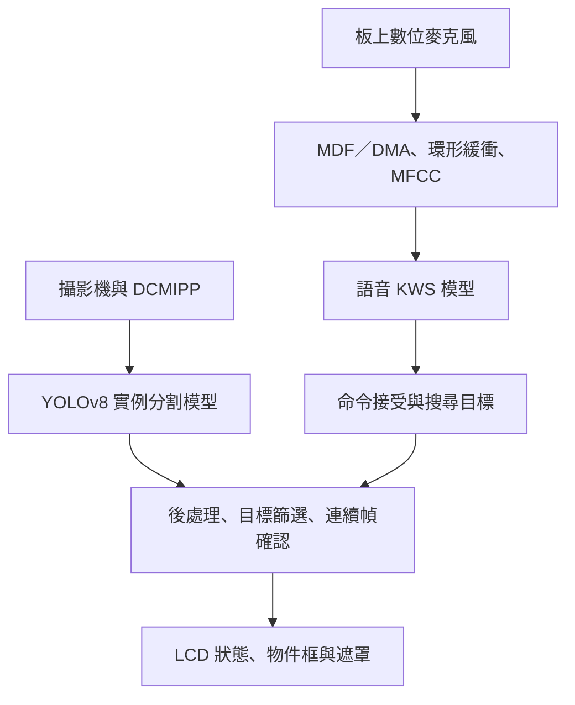

# STM32N6 雙模型語音找物系統

[繁體中文](README.md) | [English](README.en.md)

本專案是一套部署在 **STM32N6570-DK** 上的 **微控制器（MCU）級的邊緣人工智慧（Edge AI）雙模型找物系統**。板上的 STM32N657 微控制器整合 **Arm Cortex-M55 處理器與 Neural-ART 神經網路加速器（NPU）**，在同一套 FreeRTOS 韌體中執行自行訓練的關鍵字辨識模型（KWS）與 YOLOv8 實例分割模型；語音前處理、模型推論、搜尋判定及畫面顯示都由開發板完成。

## [雙模型記憶體配置與部署](docs/memory-deployment.md)

**本專案的核心工程：在同一顆微控制器上，配置主應用、兩個模型、影像緩衝、權重與執行指令。** 將模型記憶體池、韌體連結腳本與燒錄位址一起規劃，讓語音與視覺模型共用 NPU，並保有各自的工作區。

- **工作區分配：**應用 SRAM 邊界、影像與顯示緩衝，以及 KWS 專用的 **256 KiB 保留工作區**。
- **權重與指令存放：**兩模型權重的實際內容邊界、視覺執行指令分區，以及分開輸出映像的方式。
- **部署與執行交接：**五份部署映像、第一階段開機載入程式（FSBL）載入應用，以及 CPU／DMA／NPU 的快取一致性。

**[閱讀完整記憶體配置表、燒錄位置與實作依據 →](docs/memory-deployment.md)**

<h1 align="center">實機展示</h1>

<p align="center">
  <a href="https://youtu.be/m7wET9g5u6k">
    
  </a>
</p>

<p align="center">
  <a href="https://youtu.be/m7wET9g5u6k"><strong>▶ 點此觀看完整實機展示影片</strong></a>
</p>

<a id="development-route"></a>
<a id="route-foundation"></a>

## 從模型到實機：8 個開發重點

先定義語音找物的操作方式，建立正式工程並固定來源與工具版本，再完成以下流程。模型轉換、資料與訓練、板端整合、除錯及部署共同形成這套雙模型作品。

| 重點步驟 | 實作流程與產物 |
| --- | --- |
| **1. 視覺模型匯出、量化與 N6 產碼** | **Python／PyTorch（`.pt`）→ ONNX → TensorFlow SavedModel → 逐通道 INT8 量化（TFLite）→ ST Edge AI／Neural-ART → N6 網路與介面（C／H）、權重（BIN）及執行指令**。親自完成模型匯出、校正、格式轉換與產碼，再配對推論函式庫，將產物接入雙模型韌體。 |
| **2. 語音資料收集與整理** | **板上麥克風 → 五秒錄音（WAV）→ 按原始錄音分組 → 一秒切段 → MFCC 特徵**。建立杯子、瓶子、手機、其他詞語與底噪五類資料，透過 RAM 啟動工具、UART 與 CRC32 完成收音及傳輸。 |
| **3. 語音模型訓練、量化與轉換** | **Python／Keras 訓練 → SavedModel → INT8 TFLite → ST 工具內部 ONNX → Neural-ART → N6 模型程式與權重**。自行設計深度可分離卷積 KWS，加入資料增強，匯出前處理係數、尺度與零點。 |
| **4. 視覺尋物與顯示整合** | **攝影機中央裁切 → 256×256 RGB → YOLO 推論 → 框解碼／非極大值抑制（NMS）／遮罩 → LCD**。移植後處理、篩選指定物件，以連續兩幀確認結果，並用快照保護顯示資料。 |
| **5. 連續收音與 C 前處理** | **MDF／GPDMA → 環形緩衝 → 最新一秒音訊 → CMSIS-DSP／MFCC → 637 個 INT8 特徵**。將 Python 特徵流程移植到 C，處理暖機、跨界、覆寫與模型輸入檢查。 |
| **6. 雙模型排程與記憶體配置** | **兩模型依序共用 NPU，推論、顯示與 ISP 工作協作**。整合模型記憶體池與連結腳本，分配 RAM／Flash、權重及指令區，核對實際邊界，處理 CPU／DMA／NPU 快取及跨工作狀態一致性。 |
| **7. 數值比對、現場改善與定版** | **固定特徵／固定 PCM／即時音訊 → 電腦與板端比對 → 補充現場資料 → 分組五折與保留評估 → 同步定版模型及係數**。定位誤判與漏接，設計語音接受規則，將分類分數轉為穩定的目標切換事件。 |
| **8. 韌體建置、開機部署與展示** | **模型程式＋應用與函式庫 → ELF → 應用／視覺指令 BIN；搭配兩模型權重與 FSBL，組成五份部署映像**。修正封裝對齊、核對燒錄位置與更新內容，完成板端操作、IDE／Git 保存及實機影片。 |

視覺權重由產碼直接輸出為 `network_data.xSPI2.bin`；視覺指令 `network_ecblobs.h` 經連結及區段抽取成為 `vision_commands.bin`。KWS 的控制程式連入主應用，權重另存，沒有獨立的語音指令映像。開機時由 FSBL 將主應用從外部 Flash 載入內部 SRAM，再進入雙模型韌體。

**深入閱讀：**[完整工程流程](docs/engineering-workflow.md) · [32 步逐項實作](docs/development-steps.md) · [雙模型記憶體配置與部署](docs/memory-deployment.md)

說出杯子（`cup`）、水瓶（`bottle`）或手機（`phone`）的英文名稱，語音模型便選定搜尋目標；攝影機與視覺辨識持續運作，液晶螢幕（LCD）疊加搜尋狀態、物件框與分割遮罩。Cortex-M55 負責周邊控制、音訊特徵、後處理與工作排程，兩個模型依序使用共享 NPU。

系統的開機交接也納入部署：晶片內建開機程式（Boot ROM）啟動第一階段開機載入程式（FSBL），再由 FSBL 將外部快閃記憶體（Flash）中的主應用載入內部 SRAM，交接至應用啟動流程。主應用啟動 FreeRTOS，完成初始化後，建立推論、顯示與影像訊號處理工作。

**本案親自完成 YOLO 視覺模型從 Python／PyTorch、ONNX、SavedModel 到逐通道 INT8 量化的轉換流程；自行建立五分類語音資料集、設計與訓練 KWS，完成兩個模型的 N6 產碼及整合部署。** 在模型與硬體之間，將 Python 語音特徵流程移植為 C，建立電腦與板端的逐項數值比對；配置兩模型的 RAM／Flash、權重與執行指令，實作共享神經網路加速器（NPU）的排程、CPU／DMA／NPU 快取交接，以及 FreeRTOS 工作間的影像、目標狀態與顯示資料協作。開發過程也包含現場誤判分析、補充資料與重新訓練，以及啟動、映像封裝和工具鏈相容性問題的定位與修正。

**技術關鍵字：嵌入式人工智慧（Embedded AI）・微控制器（MCU）・Cortex-M55・開機交接（Boot ROM／FSBL）・C／Python・FreeRTOS 多工作・神經網路加速器（NPU）・Neural-ART・關鍵字辨識（KWS）・YOLOv8 實例分割・INT8 量化・梅爾頻率倒譜係數（MFCC）・CMSIS-DSP・MDF／GPDMA・快取一致性・DCMIPP／LCD・UART／CRC32・GDB・連結腳本（Linker script）・模型記憶體池（Memory pool）・權重與指令分區・工具鏈版本對齊・韌體部署。**

**本頁導覽：**[開發重點](#development-route) · [系統分工](#system-flow) · [開機交接](#boot-flow) · [記憶體配置](#memory-layout) · [模型部署](#model-deployment) · [語音訓練](#kws-training) · [數值除錯](#numerical-debugging) · [工具鏈與封裝](#toolchain-packaging) · [成果](#results)

**重要文件：**[工程流程（Workflow）](docs/engineering-workflow.md) · [32 步詳解](docs/development-steps.md) · [系統架構](docs/architecture.md) · [記憶體配置](docs/memory-deployment.md) · [程式導讀](docs/code-tour.md) · [完整文件導覽](#documentation)

> **版本編號說明：**`Runtime1100`、`Runtime1200`、`Runtime1201` 分別代表 ST 神經網路執行函式庫（Network Runtime）的 **11.0.0、12.0.0、12.0.1** 版本。這套函式庫在建置時連結進韌體，提供模型程式所需的執行支援；更新模型產碼工具時，也須配對函式庫、標頭檔與神經網路處理器（NPU）支援程式。這些編號與 ST Edge AI 工具本身的版本號分開記錄。 [版本配對詳解](docs/toolchain-compatibility.md)。

**已保存結果：**五折 INT8 開發驗證 **224/227（98.68%）**；定版模型在 16 段保留音訊的浮點與 INT8 評估皆為 **15/16（93.75%）**；定版板端操作的六次語音命令 **6/6 正確接受**。早期固定五類與四例即時音訊另完成板端／電腦數值對照；這些比較與語音接受紀錄各有版本及測試範圍。[結果與版本範圍](docs/results.md)

<a id="system-flow"></a>

## 系統如何運作



**視覺持續執行，語音負責切換搜尋目標。** KWS 與 YOLO 在同一個推論工作中依序使用 NPU；顯示與影像訊號處理（ISP）由另外兩個 FreeRTOS 工作協作。音訊 DMA 持續收樣，推論工作取出最新的一秒視窗。

### 處理器、NPU 與即時工作的分工

| 執行單元／工作 | 直接負責的內容 | 協作方式 |
| --- | --- | --- |
| Cortex-M55／推論工作 `nn` | 取得音訊視窗、計算 MFCC、接受語音命令；取得影像、啟動 YOLO、執行後處理與目標確認 | KWS 與 YOLO 各有上下文及輸入輸出，在同一工作內依序使用共享 NPU |
| Neural-ART NPU | 執行產碼分配的模型硬體運算階段 | 定版 KWS 包含 11 個 NPU 階段，最後 Softmax 由 CPU 執行；模型控制由產碼與執行期協調 |
| 顯示工作 `dp` | 取得結果快照，更新搜尋文字、物件框與遮罩 | 在互斥鎖內複製快照，鎖外繪圖，縮短共享資料占用時間 |
| 影像訊號處理工作 `isp` | 回應影像事件並更新攝影機 ISP | 透過號誌與相機事件協作，和推論／顯示分工 |
| MDF／GPDMA 與相機周邊 | 持續擷取音訊及影像 | DMA、中斷、緩衝與號誌交接資料；CPU／DMA／NPU 之間明確維護快取一致性 |

### 從分類分數到穩定的搜尋結果

| 判定階段 | 實際條件與作用 |
| --- | --- |
| 語音候選 | 音訊峰值至少 **2,500**、第一名分數至少 **90%**，且領先第二名至少 **25 個百分點** |
| 接受與重新啟用 | **連續兩個視窗**符合，兩次命令接受間隔至少 **1,200 ms**；接受後等待**兩個安靜視窗**才重新啟用 |
| 視覺後處理 | 信心門檻 **0.50**、非極大值抑制（NMS）的交併比門檻 **0.40**，最多保留 **10** 個結果 |
| 指定物件確認 | 對應 COCO 的 cup=41、bottle=39、cell phone=67；選取目標類別最高信心框，要求**連續兩幀且框交併比至少 0.30**才顯示找到（FOUND） |
| 目標切換與舊結果 | 接受語音命令後更新搜尋目標與世代編號，清除命中累積；推論完成後捨棄屬於舊目標的結果 |

<a id="boot-flow"></a>

## 從上電到雙模型應用：FSBL 與主程式的交接

本案採用官方 FSBL 配合主應用的**載入後執行（Load & Run）**流程。主應用映像儲存在外部 Flash 的 `0x70100000`，向量表與 CPU 程式則連結在**內部 SRAM 的 `0x34000400` 起**；兩個位址分別描述映像保存位置與程式執行配置。

| 開機階段 | 本案中的角色與交接 |
| --- | --- |
| 晶片內建開機程式（Boot ROM） | 晶片上電或重設後執行，依開機設定從開機媒體載入 FSBL 至 SRAM，交出控制權。 |
| 第一階段開機載入程式（FSBL） | 準備載入環境，將外部 Flash 中的主應用載入 SRAM，再跳至應用啟動入口。本案沿用官方 FSBL，並完成與應用封裝、位置及其他部署映像的配合。 |
| 應用啟動碼 | `Reset_Handler` 設定堆疊、呼叫 `SystemInit`、準備資料區與 C 執行環境，再進入 `main()`。 |
| FreeRTOS 初始化工作 | `main()` 完成 HAL 與 CPU 快取等基本設定，建立 `main` 工作並啟動排程器；`main_thread_fct()` 再設定時脈、UART、NPU RAM／快取、外部 RAM／Flash 記憶體映射及周邊存取屬性。 |
| 雙模型應用 | `app_run()` 初始化 LCD、相機及同步物件，建立 `nn`、`dp`、`isp` 三個工作；推論工作接續初始化共用執行期、兩模型與麥克風，開始持續收音、影像推論及畫面更新。 |

這裡的初始化順序具有實際相依性：系統時脈設定會使用延遲服務，因此程式**先啟動 FreeRTOS 排程器，再在初始化工作中設定時脈**。主應用接手後也會重新建立所需的外部記憶體映射；模型權重與視覺指令留在各自的 Flash 區域，執行時依產碼位址存取。

FSBL 的寫入位置依 `ai_fsbl.hex` 內含位址決定。應用檔名 `finder_signed.bin` 沿用既有命名，本案實際採無金鑰模式（`-nk`），完成開機標頭與對齊封裝。

開機依據：[主應用初始化](firmware/Src/main.c)、[應用工作建立](firmware/Src/app.c)、[連結配置](firmware/Gcc/STM32N657xx.ld)、[固定官方 FSBL／應用部署說明](https://github.com/STMicroelectronics/x-cube-n6-ai-hand-landmarks/blob/6c313001f69d3ddb1ffa7bd700aba74f9c11037b/README.md)。

<a id="memory-layout"></a>

## 工程重點：雙模型記憶體配置與部署

**兩個模型的共存，涉及應用連結位址、模型工作區、權重與執行指令的共同配置。** 本案重新配置主應用與 YOLO 的記憶體邊界，再切出 KWS 專用區域；同時處理 CPU／DMA／NPU 快取與資料生命週期。

| 執行時用途 | 位置與保留容量 | 已保存的配置結果 |
| --- | --- | --- |
| 主應用、FreeRTOS、驅動與兩模型 CPU 控制程式 | 內部 SRAM，`0x34000400` 起，**1,023 KiB** | 定版連結用量 **535,544 B**；區域結束於 `0x34100000`，避開視覺模型工作區 |
| YOLO 活化值與輸入輸出 | 模型池中的內部 SRAM／NPU RAM，以及 `0x90000000` 起的外部 RAM 池 | 由視覺模型產碼配置；與應用連結器統計分開追蹤 |
| 相機、LCD、後處理與遮罩快照 | 外部 PSRAM，`0x91000000` 起，**15.75 MiB** | 連結區段用量 **8,949,920 B**；尾端止於 KWS 專區 |
| KWS 活化值與輸入輸出 | 外部 PSRAM，`0x91FC0000` 起，**256 KiB** | 模型產碼配置 **17,440 B**，採絕對位址使用 |

| 非揮發儲存內容 | 外部 Flash 位置 | 配置用途 |
| --- | --- | --- |
| 第一階段開機載入程式（FSBL） | 依 `ai_fsbl.hex` 內含位址 | 載入主應用並交接至 SRAM 中的啟動碼 |
| 主應用開機映像 | `0x70100000` | 儲存封裝映像；應用的連結執行位置是上表內部 SRAM |
| YOLO 權重 | `0x70380000` | 與 KWS 權重依實際映像邊界核對；已記錄視覺權重為 **3,474,865 B** |
| KWS 權重 | `0x70700000`，保留 **64 KiB** | 模型產碼配置 **11,409 B** |
| YOLO 執行階段控制器指令（EC blob） | `0x71380000`，保留 **2 MiB** | 獨立指令區段用量 **230,528 B** |

**實際完成的配置工作：**應用 SRAM 由 1,535 KiB 調整為 1,023 KiB；16 MiB PSRAM 尾端切出 256 KiB 給 KWS；視覺指令與應用從同一 ELF 分開輸出，避免跨位址空洞使映像膨脹。KWS 控制程式連入主應用，沒有另外一份 KWS EC blob。

### 三個配置層必須一起調整

| 配置層 | 管理的內容 | 本案實作 |
| --- | --- | --- |
| 模型記憶體池（`.mpool`） | 模型編譯器配置權重、活化值及輸入輸出的範圍與存取屬性 | KWS 另設 `0x91FC0000` RAM 與 `0x70700000` Flash，使用獨立網路名稱與產碼符號 |
| 韌體連結腳本與區段屬性 | CPU 程式、FreeRTOS、全域資料、顯示／後處理緩衝與視覺指令 | 限制應用 SRAM；配置 `.flash_section` 與 `.psram_section (NOLOAD)`，並切出 KWS 專用 RAM |
| 封裝與燒錄清單 | 實際寫入的內容、位址、長度、開機標頭與對齊 | 配對 FSBL、主應用、兩模型權重及視覺指令，核對各映像雜湊與內容邊界 |

### 權重邊界與記憶體用量的判讀

本版視覺權重自 `0x70380000` 起、長 **3,474,865 B**，實際末端為 `0x706D05B1`（不含），距 KWS 權重起點 `0x70700000` 尚有 **195,151 B**。上游視覺 Flash 模型池的可配置範圍是 `0x70380000–0x71380000`，涵蓋這個 KWS 位置；因此重產視覺模型時，必須再次核對實際產物與產碼使用範圍，不能直接沿用整個 16 MiB 池作為雙模型權重的可用上限。

KWS 區域在連結器顯示 **0 B**，是因為模型產碼以絕對位址使用 RAM；模型報告仍記錄 **17,440 B** 的活化值配置。保留容量、連結器用量、模型產碼配置與執行期間峰值各有不同意義。PSRAM 的 `NOLOAD` 工作緩衝不作為初始化資料塞入燒錄映像；視覺指令則獨立抽出，避免將跨位址空洞寫進應用 BIN。

<a id="route-vision"></a>
<a id="model-deployment"></a>

## 兩個模型如何部署到 N6

| 項目 | 語音模型 | 視覺模型 |
| --- | --- | --- |
| 模型與產物建立方式 | 本專案設計、訓練並量化的小型深度可分離卷積模型 | 親自完成 YOLOv8n-seg 的 Python／PyTorch 匯出、ONNX／SavedModel 轉換與逐通道 INT8 量化，再產生及整合 N6 網路、介面、權重與指令；[完整轉換流程與紀錄](vision/deployment/README.md) |
| 輸入 | 一秒 PCM 經 MFCC，形成 `49×13×1 INT8` | `256×256 RGB UINT8` |
| 輸出 | `cup`、`bottle`、`phone`、`unknown`、`silence` 五類 | `116×1344` 偵測資料與 `64×64×32` 遮罩原型，皆為 INT8 |
| 部署流程 | Keras 訓練／SavedModel → INT8 TFLite → ST Edge AI 內部 ONNX／量化資訊 → Neural-ART 產碼 | Python／PyTorch（`.pt`）→ ONNX → TensorFlow SavedModel → 逐通道 INT8 量化（TFLite）→ ST Edge AI／Neural-ART → N6 網路與介面（C／H）、權重（BIN）及執行指令 → 執行期配對、韌體整合與映像部署 |
| 應用整合 | C 特徵前處理、尺度／零點檢查、命令接受與切換目標 | 後處理介面移植、指定類別篩選、連續幀確認與座標映射 |

視覺部署在本案 `vision/` 中執行 `generate-n6-model_STM32N6570-DK.sh`，完成 N6 產碼、參考工程編譯及映像封裝，再將模型程式、STAI 介面、權重與執行指令移入 `firmware/`。模型來源與工具版本固定保存，移植過程完成以下相容性與配置工作：

| 移植項目 | 實際處理 |
| --- | --- |
| 產碼與執行期配對 | 視覺參考工程的執行期由 1200 換成 1201；手部底座由 1100 換成 1201，同步替換標頭、函式庫與 NPU 支援來源，統一連結 `NetworkRuntime1201_CM55_GCC.a` |
| 後處理與模型替換 | 移入 ST 後處理核心及轉接層，改寫模型與後處理編譯清單，選用 YOLOv8 實例分割介面；設定 80 類、1,344 個候選框及 32 張 64×64 遮罩原型 |
| 指令與緩衝區配置 | 將視覺指令的輸入區段 `.flash_blob` 收進 Flash 輸出區段 `.flash_section`；後處理緩衝 `.psram_bss` 收進 PSRAM 的 `.psram_section (NOLOAD)`，應用與視覺指令從 ELF 分開輸出 |

這條移植流程及各階段成功回報整理於[原始開發歷程](docs/original-history-review.md)，涵蓋模型產碼、參考工程建置、正式韌體移植及板端運作。

KWS 的[原始編譯紀錄](docs/evidence/development-history/codegen_20261008/codegen.log)保存工具內部 ONNX 轉換與 Neural-ART 呼叫。定版配置包含 **11 個 NPU 硬體執行階段與 1 個 CPU Softmax 階段**，權重配置 **11,409 位元組**、活化值配置 **17,440 位元組**；未產生獨立的 KWS 執行階段控制器指令包（EC blob）。

兩個模型各有網路介面與上下文，共用初始化一次的推論執行環境。視覺模型版本與來源固定在 [sources.txt](sources.txt)，KWS 版本則由[模型雜湊與產碼設定](kws/deployment/README.md)追溯。

### 模型產碼如何成為可執行韌體

視覺移植時，實際從參考工程移交六份產物，再同步修改正式韌體的編譯清單、模型初始化、後處理介面與記憶體區段：

| 產碼產物 | 在正式工程中的用途 |
| --- | --- |
| `network.c`、`network.h` | 網路執行與模型控制介面，參與 CPU 韌體建置 |
| `stai_network.c`、`stai_network.h` | STAI 模型介面、上下文及輸入輸出資訊，供應用初始化與呼叫 |
| `network_ecblobs.h` | 視覺執行階段控制器指令，經連結與區段抽取形成 `vision_commands.bin` |
| `network_data.xSPI2.bin` | 視覺權重，依部署配置另行寫入外部 Flash |

KWS 另用獨立網路名稱與模型池產碼，將自己的程式及介面連入同一應用，權重另存專區。重新訓練後，模型程式、權重、MFCC 係數、尺度及零點必須一起更新；定版輸入零點由 **8 改為 7**，並在 C 程式中核對模型介面。KWS 本版的階段控制由官方工具產生的 C 程式負責，沒有另外一份 KWS EC 指令包。

<a id="audio-capture"></a>

## 收音資料流程與連續音訊輸入

資料蒐集子系統建立板上數位麥克風到電腦資料集的完整路徑：啟用開發板串列功能（BSP COM）與 HAL UART，將兩個 UART 驅動來源加入 IDE 連結，經多功能數位濾波器（MDF）取得音訊。以 MDF 錄音範例的周邊設定為基礎，加入區塊數、最小值、最大值及峰對峰值監測，再實作獨立五秒錄音與傳輸流程。

錄音採用「先在 RAM 收滿五秒，再傳回電腦」：DMA 半滿／全滿回呼略過暖機區塊並複製樣本，主迴圈處理逾時、錯誤、錄音長度及 CRC32。

主機工具核對映像大小、初始堆疊與入口向量，透過 GDB 載入 RAM、設定核心狀態，並以 `main`／`MicLine` 中斷點確認啟動；接收端處理串列獨占、非阻塞讀取、期限、交握、完整長度、結尾與 CRC32，確認完整後保存 WAV。分類收集工具支援中止後接續，並保留來源與工作階段資訊。

整合到雙模型後，收音改為持續運作：

- **共享時脈與權限**：保留既有 PLL2，只設定麥克風的 IC8 分頻；配置 PE2／PE8、MDF 與 DMA 存取屬性。
- **DMA 與快取**：循環鏈結描述節點與樣本緩衝分別對齊 64／32 位元組；回呼完成快取處理後，用記憶體屏障發布環形緩衝位置。
- **滑動視窗一致性**：名目 16 kHz、32,768 點環形緩衝、每窗 16,000 點；累積至少 3,200 個新樣本才可取窗（名目約 200 ms），實際間隔受 DMA 區塊與工作排程影響；處理環形跨界，若複製過程延遲到資料可能被覆寫，就捨棄該次快照。

<a id="route-kws"></a>
<a id="route-finalization"></a>
<a id="kws-training"></a>

## 資料工程與 KWS 訓練演進

建立 `cup`、`bottle`、`phone`、`unknown`、`silence` 五分類資料。以短時能量切出發音、限制相鄰單字邊界並補成一秒；先依原始錄音分組，再切片，讓同一來源的相近片段保持在同一分組。

初版收集 47 段五秒錄音，整理成 142 段訓練、49 段驗證片段；錄音數與切段數分開計算。訓練從初版離線驗證，經現場資料補訓，演進到分組交叉驗證定版。[訓練歷程](kws/training_history/README.md)按版本整理各版程式、訓練輸出與評估狀態。

- **特徵與網路**：49×13×1 MFCC 輸入、深度可分離卷積網路、類別權重與 INT8 匯出。
- **現場資料改進**：補充板上語音及底噪；加入增益、噪音和時間平移，依發音邊界限制平移幅度，避免增強時截掉單字。
- **資料洩漏防護**：以 PCM 雜湊識別相同內容並合併來源組別，拒絕標籤矛盾及開發／保留資料重複；每折的標準化與背景噪音只來自訓練組。
- **可追溯評估**：檢查每折類別覆蓋與組別不交疊，五折選輪後以 66 輪完成最終訓練；現場收集清單另保存 48 段音訊的用途與雜湊，其中 32 段供訓練、16 段保留。

定版開發池共有 **227 段**：原始訓練 142 段＋原始驗證 49 段＋早期現場 4 段＋新增現場訓練 32 段。原來 49 段驗證資料納入開發池後，另外保留的 **16 段現場音訊**負責最終評估。五折各自只用該折訓練資料計算標準化、背景噪音與 INT8 校正資料；最佳訓練輪數為 **82、28、66、9、79**，取中位數 **66 輪**，再使用全部 227 段訓練定版模型。

<a id="route-debugging"></a>
<a id="numerical-debugging"></a>

## Python／C 數值對照與問題定位

### 電腦訓練與板端 C 共用的特徵規格

| 處理步驟 | 固定參數與輸出 |
| --- | --- |
| 音訊視窗 | 一秒、16,000 點、16 位元單聲道；先去除平均值 |
| 分框與頻譜 | **480 點漢寧窗（Hann window）、320 點位移、512 點快速傅立葉轉換（FFT）**，計算功率頻譜 |
| 聲學特徵 | **40 個梅爾濾波器（Mel filters）**、自然對數、**13 維離散餘弦轉換（DCT）**，得到 **49×13×1** MFCC |
| 標準化與量化 | 使用訓練組計算的參數，截限至 **±6**，依模型尺度與零點轉為 **637 個 INT8 特徵值** |
| 板端一致性 | 匯出同版窗函數、濾波器、DCT 與標準化係數；C 程式處理實數 FFT 的直流／奈奎斯特位置，避免電腦與板端前處理定義不同 |

板端用 CMSIS-DSP 浮點 FFT，接續 Mel 濾波、對數及 DCT，再標準化、截限並量化成 INT8。移植時處理實數 FFT 的直流／奈奎斯特儲存位置，並在編譯及初始化階段檢查形狀、型別、尺度與零點。FFT 與特徵工作區採靜態配置，由單一推論工作使用。

除錯分三層：**固定 INT8 輸入測模型 → 同一 PCM 測完整 C 前處理 → 回傳即時 PCM、特徵與輸出，在電腦重算。**

快取交接依實際運算位置處理：更新 KWS 輸入前，先回寫並使 NPU 舊快取失效；CPU 寫入特徵後，再回寫 CPU 快取。最後的機率轉換（Softmax）由 CPU 執行，因此直接讀取 CPU 輸出。這些是移植時的快取維護與排查工作；以下數值比對另外確認輸入、前處理與推論輸出的對應關係。

| 2026-10-07 比較 | 實際結果與用途 |
| --- | --- |
| 五類固定樣本，分別走直接特徵（INPUT）與原始音訊（PCM）兩條路徑 | 五類各一段，共十列比較，預測均與電腦一致；PCM 路徑每段 637 個 INT8 特徵逐項一致。兩路皆有四類輸出差異為 0，silence 最大差異為 1 個量化整數單位 |
| 四個即時視窗回傳至電腦重算 | silence、cup、bottle、phone 的 INT8 特徵差異皆為 0；輸出最大整數差異依序為 0、0、3、1 |

五類各一個固定樣本分別驗證兩條路徑，用來檢查模型部署與前處理一致性；定版分類表現則由前述分組驗證與保留音訊評估。各次比較的版本與方法見[比較過程](docs/original-history-review.md)。

其中一個安靜視窗在板端、電腦直接特徵輸入及電腦完整前處理三路都被判為 `phone`。這個比對把當次問題定位到模型／資料表現，支持後續現場資料迭代；失敗案例與後來定版結果分開保存。

早期離線驗證即有 48/49，但補入四段現場聲音後，一輪帶標籤的六次口令仍只接受兩次。因此再加入逐窗分數、分差、命中數及削波統計，擴充現場資料並採分組五折選輪，最後完成前述定版保留測試與板端 6/6 語音接受紀錄。

<a id="route-runtime"></a>
<a id="runtime-coordination"></a>

## FreeRTOS 多工作與共享資源整合

在 Cortex-M55 上，推論、顯示與影像訊號處理（ISP）三個工作協作。**視覺持續執行；語音切換搜尋目標。KWS 與 YOLO 在同一推論工作中依序使用 NPU。**

| 工程問題 | 程式中的處理方式 |
| --- | --- |
| 相機回呼在中斷中取得空閒緩衝 | 區分中斷與工作情境，中斷路徑使用 `xSemaphoreTakeFromISR` 與 `portYIELD_FROM_ISR`，工作路徑保留一般號誌介面 |
| 相機擷取與推論共用資料 | 將相機緩衝複製至模型輸入、完成快取維護後才歸還，分開擷取與推論的資料生命週期 |
| CPU／DMA／NPU 看見不同資料 | DMA 接收後處理 CPU 快取；CPU 寫新模型輸入前處理 NPU 舊快取，寫入完成再清理 CPU 快取，搭配對齊與記憶體屏障 |
| 推論途中切換目標 | 用目標世代編號核對結果，捨棄屬於舊目標的過期推論，重新累積連續命中 |
| 後處理覆寫正在顯示的遮罩 | 模型輸出先複製為結果快照，顯示工作在互斥鎖內再取得繪圖快照，於鎖外繪製 |
| 相機裁切與 LCD 位置不一致 | 從顯示視野取中央正方形作為 256×256 模型輸入，再將框與遮罩映射回 LCD 對應區域 |
| 語音重複接受或不穩定 | 綜合音量、分數、分差、連續兩窗、最短間隔及安靜後重新啟用條件 |
| 物件框短暫跳動 | 篩選指定類別的最高信心結果，連續兩幀且框交併比（IoU）至少 0.30 才顯示找到（FOUND） |
| 語音通路執行期間回傳錯誤 | 停用語音並顯示錯誤，保留視覺工作繼續執行 |

上述實作將連續音訊、兩個模型、搜尋狀態與顯示資料串成協作流程，並明確處理中斷情境、資料所有權與結果有效期。語音錯誤處理的適用範圍與驗證狀態見[系統架構](docs/architecture.md)及[實作索引](docs/development-coverage.md)。

<a id="toolchain-packaging"></a>

## 雙模型產碼、執行期與封裝整合

本案以 ST Edge AI 4.0.1 產碼，統一兩模型使用的執行期、建置區段與映像封裝規則，完成從模型產物到板端應用的部署。以下列出開發時採用的官方版本、原設定與本案修正，包含官方文件與 Makefile 在封裝對齊要求上的具體差異。

| 官方來源與原設定 | 本案的整合處理 | 完成結果 |
| --- | --- | --- |
| ST 實例分割範例 `42f7d645…`：README 基準為 **ST Edge AI 4.0.0**，Makefile 連結 **Runtime1200**；產碼腳本呼叫系統路徑中的 `stedgeai` | 本案使用 **4.0.1** 產碼，配對 **Runtime1201**，同步更新標頭、函式庫與 NPU 支援來源 | 視覺產碼、參考工程連結與正式工程移植完成 |
| ST 手部雙模型範例 `6c313001…`：README 基準為 **3.0.0**，GCC 建置連結 **Runtime1100** | 將正式韌體底座統一至 **Runtime1201**，讓 YOLO 與 KWS 使用匹配的共用執行環境 | 雙模型 GCC 工程成功建置 |
| ST 分割範例的 CubeIDE `ModelZoo` 組態有視覺指令／後處理區段定義，獨立 Makefile 未帶相同設定 | 在正式 Makefile 明確加入 Flash／PSRAM 區段巨集，並分開輸出應用與視覺指令 | 指令與大型後處理緩衝落入預定區域，映像不因位址空洞膨脹 |
| 同版 ST 分割範例 README 要求 CubeProgrammer **2.21 以上加 `--align`**，但 Makefile 的封裝規則未帶對齊選項 | 本案封裝流程補上對齊，確認有效載荷偏移由 **`0x240` 修正為 `0x400`**，且程式內容一致 | 後續定版紀錄確認應用與 KWS 權重寫入驗證成功，板端完成六次正確語音接受與目標對應 |

版本配對屬跨工具版本的移植工作；封裝部分則有同一官方提交中文件與 Makefile 的具體差異。**[官方原始檔、建置指令、修正與成功紀錄](docs/toolchain-compatibility.md)**逐項說明，並保留本案實際採用的 GCC 路徑。

本案早期視覺版已使用 `0x400` 對齊；後續整合即時語音版時，封裝指令曾遺漏對齊選項，造成寫入驗證成功卻沒有正常啟動輸出。逐位元組比較確認程式內容相同後，恢復無金鑰封裝的對齊設定，將有效載荷由 `0x240` 修正為 `0x400`，之後恢復 KWS 輸出並繼續雙模型測試。這次定位同時處理官方入口差異與本案整合時的設定回歸。

<a id="route-delivery"></a>
<a id="build-delivery"></a>

## 建置與工程交付

在已具備匹配模型產碼、權重、執行環境與 SDK 的完整專案根目錄，既有建置入口為：

```bash
bash firmware/STM32CubeIDE/STM32N6570-DK/cubeide_make.sh \
  build_finder_ide/Project.elf \
  build_finder_ide/Project.bin \
  build_finder_ide/vision_commands.bin
```

此入口核對 GCC 14.3.1，支援 `GCC_PATH`，並以專案相對路徑呼叫 Makefile。它產生應用 ELF、未封裝應用與獨立視覺指令；映像封裝與寫入依[建置說明](docs/build.md)及[部署配置](docs/memory-deployment.md)處理。

完整交付組合為 **FSBL、主應用、視覺權重、KWS 權重、視覺指令**五份映像。FSBL 依 HEX 內含位址寫入，其餘各有固定位置；保存來源、模型版本與映像雜湊。定版更新紀錄確認應用與 KWS 權重兩份寫入驗證成功，其餘沿用既有內容。

IDE 來源同步工具另處理連結核對、預覽、備份、雜湊競態檢查與原子替換，使來源瀏覽入口對應工程內容。公開庫補入[視覺產碼來源與配置入口](vision/deployment/README.md)，搭配既有 [KWS 產碼配置](kws/deployment/README.md)，讓兩個模型的部署流程都有可追溯入口。

### 建置、封裝與寫入各自產生什麼

| 階段 | 輸出與用途 |
| --- | --- |
| 編譯與連結 | `Project.elf` 保存程式、符號與連結區段，用來檢查記憶體配置；兩個模型與共用執行期連入同一應用 |
| 分開抽取 | `Project.bin` 排除視覺指令區段；`vision_commands.bin` 只抽取 `.flash_section` |
| 主應用封裝 | 加入 FSBL 載入所需的開機標頭，核對有效載荷位於 **`0x400`** 且內容與原始 BIN 一致 |
| 寫入部署 | FSBL 依 HEX 位址；主應用、YOLO 權重、KWS 權重及 YOLO 指令按上方五映像表寫入並核對 |
| 定版更新 | 保存主應用 `0x70100000` 與 KWS 權重 `0x70700000` 的寫入及驗證成功紀錄；其他三份沿用既有配置 |

目前已核對的工具組合為 **GCC 14.3.1、ST Edge AI 4.0.1、Neural-ART 1.1.3-275、Runtime1201、HAL 1.3.0、FreeRTOS 10.6.2、STM32CubeIDE 2.2.0**。公開庫保留程式與設定，完整重建仍需同版模型產碼、權重及相依工具。

<a id="results"></a>

## 已有結果與適用範圍

| 項目 | 結果 | 證據與解讀 |
| --- | --- | --- |
| 五折 KWS INT8 開發驗證 | **224/227，98.68%** | [五折報告](docs/evidence/kws-groupcv.json)；用於開發與選輪 |
| 定版保留音訊 | **浮點與 INT8 皆 15/16，93.75%** | [保留報告](docs/evidence/kws-int8-holdout.json)；16 段單窗離線分類結果一致，一例 cup 判為 phone |
| 早期固定樣本部署比較 | **五類在 INPUT／PCM 兩路皆正確；PCM 特徵差異為 0** | [比較歷程](docs/original-history-review.md)；五類各一段，兩路輸出最大差異皆不超過 1 個量化整數單位 |
| 早期即時部署一致性 | **四例 INT8 輸入特徵差異皆為 0** | [比較紀錄](docs/evidence/development-history/live_comparison_20261007.json)；用於定位數值與移植問題 |
| 定版板上語音紀錄 | **6/6 正確接受：cup、bottle、phone 各兩次** | [操作日誌](docs/evidence/development-history/voice_groupcv_20261008.log)；接受後目標與命令一致；後續五次可見目標類別切換，同輪 53 列視覺均為 `found=0` |
| 本案早期視覺整合 | CUP、PHONE 有 `found=1` | [視覺日誌](docs/evidence/development-history/finder_vision_20261004.log)；與定版語音紀錄分屬不同版本 |

[實機展示影片](https://youtu.be/m7wET9g5u6k)已提供；本雙模型版本的獨立供電與冷啟動尚未列為實測通過。[完整結果與版本對照](docs/results.md)

<a id="documentation"></a>

## 專案文件導覽

以下列出本專案全部 22 組中英文說明文件，依閱讀目的分類。每份文件頁首都可切換語言；上方首頁正文保留完整技術介紹。

### 開發流程與系統設計

| 文件 | 內容 |
| --- | --- |
| [工程流程（Workflow）](docs/engineering-workflow.md) | 資料、模型、數值移植、系統整合與部署的完整流程。 |
| [完整 32 步開發詳解](docs/development-steps.md) | 每一步的做法、產物、結果與程式入口。 |
| [系統架構](docs/architecture.md) | 音訊、影像、雙模型、即時工作與應用狀態如何協作。 |
| [雙模型記憶體與部署](docs/memory-deployment.md) | RAM／Flash、模型池、連結區段、權重邊界與五份映像配置。 |
| [程式導讀](docs/code-tour.md) | 依模組與函式閱讀收音、前處理、模型推論及系統整合實作。 |
| [實作與證據索引](docs/development-coverage.md) | 將工程項目對應到原始碼、設定及結果紀錄。 |

### 模型、資料與開發工具

| 文件 | 內容 |
| --- | --- |
| [視覺模型產碼](vision/deployment/README.md) | YOLO 產碼輸入、六份產物、工具設定與移植交接。 |
| [語音模型產碼配置](kws/deployment/README.md) | KWS 網路名稱、記憶體池及 Neural-ART 產碼設定。 |
| [獨立錄音韌體](kws/recording_firmware/README.md) | 五秒錄音、DMA 收樣與串列傳輸的板端原始碼。 |
| [收音與串列工具](kws/recording_tools/README.md) | RAM 啟動、交握、CRC32 檢查、音訊接收與 WAV 保存。 |
| [訓練版本演進](kws/training_history/README.md) | 初版、現場補訓與分組交叉驗證的演進及各版結果。 |
| [定版訓練快照](kws/training_snapshot/README.md) | 定版特徵處理、模型訓練、量化與分組驗證程式。 |
| [33 份原始開發流程](tools/development-history/README.md) | 視覺移植、封裝修正、數值比對、資料收集及部署程式。 |

### 建置、除錯與工程交付

| 文件 | 內容 |
| --- | --- |
| [建置與外部依賴](docs/build.md) | 工具版本、建置指令、輸出產物與完整重建的依賴。 |
| [工具鏈相容性與封裝修正](docs/toolchain-compatibility.md) | 官方範例版本差異、執行期配對、區段設定與開機封裝修正。 |
| [IDE 來源同步](tools/ide/README.md) | 同步 CubeIDE 來源檔與標頭瀏覽連結，包含預覽、備份與核對。 |
| [原始開發歷程](docs/original-history-review.md) | 啟動失敗、數值比對、現場誤判及模型迭代的診斷與修正。 |

### 成果、原始證據與公開範圍

| 文件 | 內容 |
| --- | --- |
| [成果與版本範圍](docs/results.md) | 分組驗證、保留評估、數值比較、板端操作與影片。 |
| [評估報告索引](docs/evidence/README.md) | 五折、保留評估與報告來源／雜湊。 |
| [開發原始證據](docs/evidence/development-history/README.md) | 產碼、記憶體、建置、寫入、數值比較及操作日誌。 |
| [公開材料盤點](docs/publication-review.md) | 已公開材料、工程貢獻、來源歸屬及重建依賴。 |
| [第三方來源與授權](THIRD_PARTY_NOTICES.md) | 官方元件與模型來源、原授權及公開範圍。 |

### 版本與追溯資料

| 資料類型 | 直接連結 |
| --- | --- |
| 步驟與來源版本 | [32 步程式對照](docs/development-source-map.json) · [上游儲存庫與提交版本](docs/source-provenance.json) |
| 視覺模型來源 | [模型來源與雜湊](sources.txt) · [產碼設定來源](vision/deployment/upstream-reference.json) |
| 開發工具來源 | [收音工具來源](docs/recording-tools-provenance.json) · [33 份歷史程式來源與雜湊](tools/development-history/source-provenance.json) |
| 模型與開發證據 | [訓練、配置與評估雜湊](docs/evidence/provenance.json) · [開發證據來源](docs/evidence/development-history/source_provenance.json) |
| 公開材料核對 | [來源材料與公開位置](docs/evidence/development-history/review_inventory.json) · [公開材料核對結果](docs/evidence/publication_audit_20261120.json) |

## 原始碼與佐證索引

以下入口供查閱原始碼與核對紀錄；本頁前面的技術說明可直接連續閱讀。

<details>
<summary>展開各主題與 32 步的原始碼、設定及紀錄</summary>

| 主題 | 對應程式與紀錄 |
| --- | --- |
| 語音資料與模型開發 | [資料整理](kws/prepare_dataset.py)、[定版訓練與量化](kws/training_snapshot/README.md) |
| 板端收音與數值移植 | [收音工具](kws/recording_tools/README.md)、[連續收音](firmware/Src/finder_mic.c)、[特徵與比對](firmware/Src/finder_kws.c) |
| 視覺模型轉換與部署 | [產碼流程](vision/deployment/README.md)、[部署與移植步驟](docs/engineering-workflow.md) |
| 雙模型記憶體配置 | [記憶體配置與部署](docs/memory-deployment.md)、[連結腳本](firmware/Gcc/STM32N657xx.ld) |
| 即時系統與應用狀態 | [整合應用](firmware/Src/app.c)、[系統架構](docs/architecture.md) |
| 問題定位與工程交付 | [除錯與迭代歷程](docs/original-history-review.md)、[工具鏈與封裝修正](docs/toolchain-compatibility.md) |
| 收音資料流程與連續音訊輸入 | [獨立錄音來源與上游差異](kws/recording_firmware/README.md) · [RAM 啟動與接收工具](kws/recording_tools/README.md) · [連續收音模組](firmware/Src/finder_mic.c) |
| 資料工程與 KWS 訓練演進 | [切段與分組](kws/prepare_dataset.py) · [MFCC 與模型](kws/training_snapshot/train_kws.py) · [分組驗證與量化](kws/training_snapshot/train_kws_groupcv.py) · [版本演進](kws/training_history/README.md) |
| Python／C 數值對照與問題定位 | [前處理、推論與比較工具](firmware/Src/finder_kws.c) · [前處理係數](firmware/Inc/finder_kws_tables.h) · [原始比較與結果](docs/results.md) |
| FreeRTOS 多工作與共享資源整合 | [推論、顯示與狀態機](firmware/Src/app.c) · [相機裁切](firmware/Src/app_cam.c) · [CPU／NPU 快取順序](firmware/Src/finder_kws.c) |
| 建置與工程交付 | [連結腳本](firmware/Gcc/STM32N657xx.ld) · [Makefile](firmware/Makefile) · [KWS 建置](firmware/mks/kws.mk) · [IDE 同步](tools/ide/README.md) · [部署證據](docs/evidence/development-history/README.md) |

| 開發步驟 | 對應程式、設定與紀錄 |
| --- | --- |
| [01 定義功能與操作](docs/development-steps.md#step-01) | [目標選擇與操作邏輯](firmware/Src/app.c) |
| [02 建立正式專案並固定版本](docs/development-steps.md#step-02) | [建立視覺工程原碼](tools/development-history/vision_01_prepare_vision.sh)、[來源版本](docs/source-provenance.json)、[模型紀錄](sources.txt)、[建置入口](firmware/Makefile) |
| [03 執行 YOLO 模型轉換與 N6 產碼](docs/development-steps.md#step-03) | [本案產碼與建置原碼](tools/development-history/vision_03_generate_and_build_vision.sh)、[產碼參考腳本](vision/deployment/upstream-reference/generate-n6-model_STM32N6570-DK.sh)、[Neural-ART 設定](vision/deployment/upstream-reference/user_neuralart_STM32N6570-DK.json) |
| [04 配對模型執行期](docs/development-steps.md#step-04) | [參考執行期配對](tools/development-history/vision_02_match_vision_runtime.py)、[正式執行期配對](tools/development-history/vision_06_match_main_runtime.py)、[執行期連結設定](firmware/mks/ai.mk)、[版本差異與修正](docs/toolchain-compatibility.md) |
| [05 將手部模型工程改為 YOLO](docs/development-steps.md#step-05) | [六項產物移植](tools/development-history/vision_05_copy_vision_artifacts.sh)、[模型建置替換](tools/development-history/vision_07_update_model_build_list.py)、[模型建置清單](firmware/mks/ai.mk)、[模型初始化與推論](firmware/Src/app.c)、[啟動入口](firmware/Src/main.c) |
| [06 配置 DCMIPP 裁切與輸入](docs/development-steps.md#step-06) | [DCMIPP_PipeInitNn](firmware/Src/app_cam.c) |
| [07 移植後處理核心與轉接層](docs/development-steps.md#step-07) | [後處理移植原碼](tools/development-history/vision_08_import_postprocessing.py)、[後處理轉接](firmware/Lib/ai-postprocessing-wrapper/app_postprocess_iseg_yolo_v8_ui.c)、[應用配置](firmware/Inc/app_config.h) |
| [08 實作指定物件與連續幀確認](docs/development-steps.md#step-08) | [box_iou／目標篩選](firmware/Src/app.c) |
| [09 整合 LCD 框、遮罩與快照](docs/development-steps.md#step-09) | [Display_NetworkOutput／顯示工作](firmware/Src/app.c) |
| [10 修正相機中斷與緩衝交接](docs/development-steps.md#step-10) | [應用與中斷介面整合原碼](tools/development-history/vision_12_integrate_vision_application.py)、[相機佇列／nn_thread_fct](firmware/Src/app.c) |
| [11 配置視覺記憶體與映像區段](docs/development-steps.md#step-11) | [裁切與記憶體修改原碼](tools/development-history/vision_13_configure_camera_and_memory.py)、[連結腳本](firmware/Gcc/STM32N657xx.ld)、[區段輸出規則](firmware/Makefile) |
| [12 建立五類錄音資料](docs/development-steps.md#step-12) | [分類收集](kws/collect_n6.py)、[RAM 啟動](kws/recording_tools/n6_mic_start_and_record.sh)、[接收工具](kws/recording_tools/n6_receive_wav.py) |
| [13 切段並按原始錄音分組](docs/development-steps.md#step-13) | [speech_regions／extract_word](kws/prepare_dataset.py) |
| [14 建立 Python MFCC 前處理](docs/development-steps.md#step-14) | [features 與係數匯出](kws/training_snapshot/train_kws.py) |
| [15 設計並訓練五分類 KWS](docs/development-steps.md#step-15) | [初版訓練](kws/training_history/20261005_baseline/train_kws.py)、[定版模型設計](kws/training_snapshot/train_kws.py) |
| [16 從 SavedModel 匯出 INT8](docs/development-steps.md#step-16) | [export_int8](kws/training_snapshot/train_kws_groupcv.py) |
| [17 產生並連入第二模型](docs/development-steps.md#step-17) | [KWS 產碼主機流程](tools/development-history/generate_groupcv_model.py)、[記憶體池](kws/deployment/kws.mpool)、[產碼設定](kws/deployment/kws_neuralart.json)、[KWS 建置](firmware/mks/kws.mk) |
| [18 整合連續 MDF／GPDMA 收音](docs/development-steps.md#step-18) | [finder_mic_start／receive_block／finder_mic_take](firmware/Src/finder_mic.c) |
| [19 將前處理移植為 C](docs/development-steps.md#step-19) | [encode_mfcc](firmware/Src/finder_kws.c)、[前處理係數](firmware/Inc/finder_kws_tables.h) |
| [20 處理 CPU／DMA／NPU 快取](docs/development-steps.md#step-20) | [音訊快取交接](firmware/Src/finder_mic.c)、[kws_begin_input_update／prepare_input_cache](firmware/Src/finder_kws.c) |
| [21 協調雙模型與跨工作狀態](docs/development-steps.md#step-21) | [nn_thread_fct／dp_thread_fct／finder_select_target](firmware/Src/app.c) |
| [22 排查建置、啟動與映像封裝](docs/development-steps.md#step-22) | [封裝偏移檢查](tools/development-history/inspect_boot_payload.py)、[對齊修正原碼](tools/development-history/realign_and_flash_application.sh)、[建置與映像抽取](firmware/Makefile)、[封裝修正紀錄](docs/original-history-review.md) |
| [23 建立三層數值比對](docs/development-steps.md#step-23) | [固定參考匯出](tools/development-history/export_fixed_reference.py)、[即時接收與電腦重算](tools/development-history/compare_live_windows.py)、[finder_kws_compare／即時回傳](firmware/Src/finder_kws.c)、[固定參考資料](firmware/Inc/finder_kws_compare_data.h) |
| [24 定位現場誤判並補入樣本](docs/development-steps.md#step-24) | [現場診斷錄製](tools/development-history/record_voice_diagnostics.py)、[現場補訓](kws/train_kws.py)、[診斷與取樣](firmware/Src/finder_kws.c)、[比較結果](docs/evidence/development-history/live_comparison_20261007.json) |
| [25 設計語音接受規則](docs/development-steps.md#step-25) | [finder_voice_poll](firmware/Src/app.c) |
| [26 擴充現場資料與開發池](docs/development-steps.md#step-26) | [現場資料收集程式](tools/development-history/collect_live_dataset.py)、[資料載入](kws/training_snapshot/train_kws_groupcv.py)、[48 段清單](docs/evidence/development-history/live_dataset_manifest_20261008.json) |
| [27 防洩漏分組五折與最終訓練](docs/development-steps.md#step-27) | [make_splits／make_training／fit_model](kws/training_snapshot/train_kws_groupcv.py)、[五折報告](docs/evidence/kws-groupcv.json) |
| [28 保留評估與定版產物同步](docs/development-steps.md#step-28) | [定版安裝與建置原碼](tools/development-history/install_build_groupcv.py)、[匯出與評估](kws/training_snapshot/train_kws_groupcv.py)、[量化介面檢查](firmware/Src/finder_kws.c)、[保留報告](docs/evidence/kws-int8-holdout.json) |
| [29 配置五映像並完成定版寫入](docs/development-steps.md#step-29) | [定版寫入與驗證原碼](tools/development-history/flash_groupcv.py)、[連結腳本](firmware/Gcc/STM32N657xx.ld)、[定版寫入清單](docs/evidence/development-history/deployment_20261008/flash_manifest.json)、[寫入驗證](docs/evidence/development-history/deployment_20261008/flash_verified.json) |
| [30 完成定版語音操作測試](docs/development-steps.md#step-30) | [定版操作錄製](tools/development-history/record_voice_groupcv.py)、[接受與目標切換](firmware/Src/app.c)、[板端操作日誌](docs/evidence/development-history/voice_groupcv_20261008.log) |
| [31 整理 IDE、Git 與公開工程](docs/development-steps.md#step-31) | [IDE 同步工具](tools/ide/sync_cubeide_sources.py)、[編譯入口](firmware/STM32CubeIDE/STM32N6570-DK/cubeide_make.sh)、[來源紀錄](docs/source-provenance.json) |
| [32 完成實機展示影片](docs/development-steps.md#step-32) | [實機影片](https://youtu.be/m7wET9g5u6k)、[展示應用](firmware/Src/app.c) |

每步的完整說明見[32 步開發詳解](docs/development-steps.md)；既有[工程流程](docs/engineering-workflow.md)與[實作索引](docs/development-coverage.md)保留各項程式、配置與結果的對照。

保留容量、連結器用量與模型產碼配置量各有不同意義。KWS 區域在連結器顯示 0 B，是因為產碼採絕對位址配置。視覺上游 Flash 模型池的容量也不等於權重實際長度；本版依已記錄產物邊界核對與 KWS 的間隔，重新產碼時仍須核對。**[完整位址配置、分配責任與映像邊界](docs/memory-deployment.md)**列出細節與原始依據。

</details>

## 模型與平台來源

視覺部分由作者親自完成 Python／PyTorch 匯出、ONNX／SavedModel 轉換、逐通道 INT8 量化、介面核對與 N6 產碼，接續執行期、後處理、記憶體、映像與搜尋應用整合；語音部分自行建立資料集，完成 KWS 網路設計、訓練、量化及板端部署。[視覺轉換紀錄](vision/deployment/README.md)連到各階段實作及成功日誌，並分別保存產碼批次的輸入版本。韌體以 ST 手部雙模型範例的啟動、FreeRTOS 工作及相機框架為基礎；HAL、BSP、CMSIS-DSP、ST 推論執行期，以及視覺解碼、非極大值抑制（NMS）與遮罩重建保留原來源與授權。各元件的來源版本及本案修改入口見[來源與實作範圍](docs/publication-review.md)。

公開儲存庫提供應用與訓練原始碼、配置、修補及工程證據。模型權重、模型產碼、原始錄音與預建映像未隨庫提供；完整建置須具備[對應依賴](docs/build.md)。
