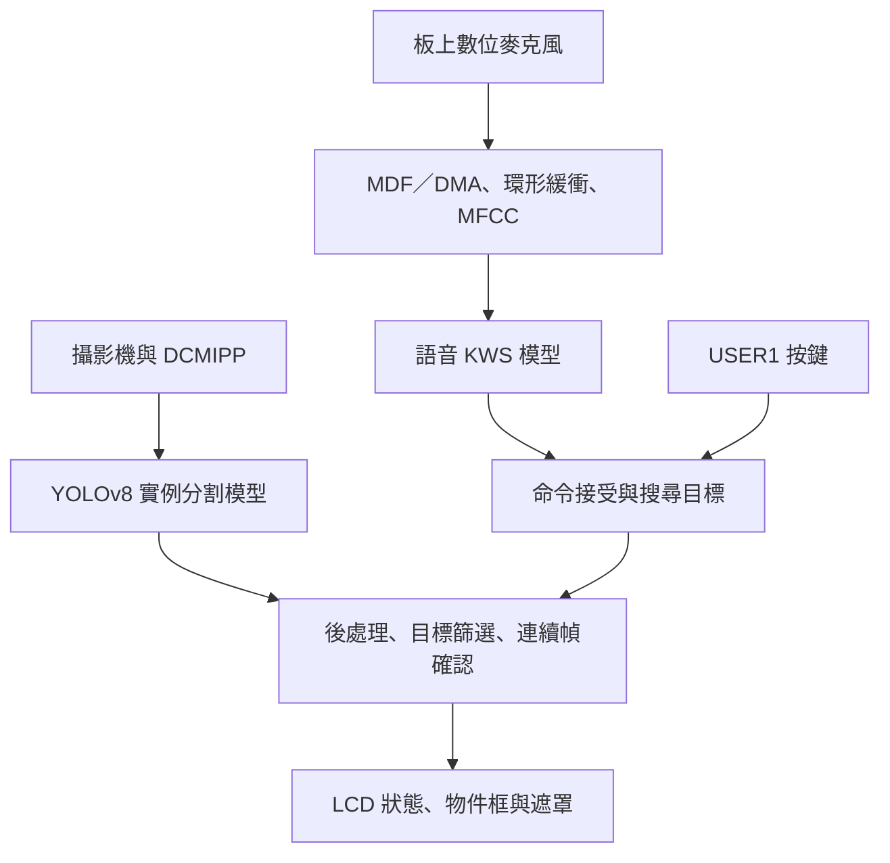

# STM32N6 雙模型語音找物系統

[繁體中文](README.md) | [English](README.en.md)

**技術關鍵字：嵌入式人工智慧（Embedded AI）・C／Python・FreeRTOS 多工作・神經網路加速器（NPU）・Neural-ART・關鍵字辨識（KWS）・YOLOv8 實例分割・INT8 量化・梅爾頻率倒譜係數（MFCC）・CMSIS-DSP・MDF／GPDMA・快取一致性・DCMIPP／LCD・UART／CRC32・GDB・記憶體配置與韌體部署。**

在 **STM32N6570-DK** 上，從需求、模型與資料建立，到板端整合、除錯及部署，完成一套由語音指定搜尋目標的雙模型系統。說出 `cup`、`bottle` 或 `phone`，自行訓練的語音模型選定目標；持續運作的 YOLOv8 實例分割模型尋找該物件，LCD 顯示搜尋狀態、物件框與遮罩。USER1 按鍵也能切換目標。

本案以 ST 官方手部雙模型範例建立 FreeRTOS 韌體底座，接入官方已量化的 YOLOv8 視覺模型，並建立自己的五分類語音資料與 KWS 模型。工程重點是把**資料、兩個模型、音訊與影像周邊、共享 NPU、記憶體及應用狀態**整合成同一套 MCU 韌體。

**已保存結果：**五折 INT8 開發驗證 **224/227（98.68%）**；定版模型在 16 段保留音訊的浮點與 INT8 評估皆為 **15/16（93.75%）**；早期四例板端／電腦比較的 INT8 特徵完全一致。[結果與版本範圍](docs/results.md)

## 系統如何運作

**視覺持續執行，語音負責切換搜尋目標。** KWS 與 YOLO 在同一個推論工作中依序使用 NPU；顯示與影像訊號處理（ISP）由另外兩個 FreeRTOS 工作協作。音訊 DMA 持續收樣，推論工作取出最新的一秒視窗。

## 從零建立到板端部署

| 階段 | 本專案完成的工作 | 程式與紀錄 |
| --- | --- | --- |
| 1. 建立需求與韌體底座 | 三種尋物命令與兩種非命令類別；以 ST 範例接入攝影機、顯示、FreeRTOS 與 NPU 執行環境 | [主程式](firmware/Src/main.c)、[整合應用](firmware/Src/app.c) |
| 2. 建立視覺尋物通路 | 接入 ST 量化模型與後處理；中央方形裁切、模型介面核對、類別篩選、物件框與遮罩顯示 | [相機配置](firmware/Src/app_cam.c)、[後處理介面](firmware/Lib/ai-postprocessing-wrapper/app_postprocess_iseg_yolo_v8_ui.c) |
| 3. 建立語音資料流程 | 接入板上錄音與接收工具；分類收集、格式檢查、來源資訊、能量切段及原始錄音分組 | [收集程式](kws/collect_n6.py)、[資料整理](kws/prepare_dataset.py)、[收音工具](kws/recording_tools/README.md) |
| 4. 建立與訓練 KWS | MFCC、深度可分離卷積、資料增強、類別權重、現場資料迭代、分組五折驗證與 INT8 匯出 | [訓練歷程](kws/training_history/README.md)、[定版訓練](kws/training_snapshot/README.md) |
| 5. 部署第二個模型 | 獨立網路名稱、STAI 上下文與 RAM／Flash 區域；ST Edge AI 產碼後與視覺模型共同連結 | [產碼設定與命令](kws/deployment/README.md)、[KWS 建置清單](firmware/mks/kws.mk) |
| 6. 移植連續收音與前處理 | MDF／循環 DMA、快取與環形緩衝；將 Python 特徵流程移植為 C，核對量化介面 | [finder_mic.c](firmware/Src/finder_mic.c)、[finder_kws.c](firmware/Src/finder_kws.c) |
| 7. 分層除錯與資料改進 | 固定特徵、固定 PCM、即時視窗比對；回傳 PCM／特徵／輸出，追查早期安靜誤判並補入現場資料 | [比較程式](firmware/Src/finder_kws.c)、[比較紀錄](docs/evidence/development-history/README.md) |
| 8. 完成系統整合 | 兩模型依序共用 NPU、語音接受狀態機、目標世代、遮罩快照、顯示協作與按鍵操作 | [app.c](firmware/Src/app.c)、[系統架構](docs/architecture.md) |
| 9. 建置、寫入與定版 | 記憶體與映像分區、版本與雜湊、應用／KWS 權重寫入驗證、訓練快照與 IDE 來源同步 | [連結腳本](firmware/Gcc/STM32N657xx.ld)、[部署紀錄](docs/evidence/development-history/README.md)、[IDE 工具](tools/ide/README.md) |

完整步驟見[開發流程](docs/engineering-workflow.md)；每階段的實作與證據見[工作對照](docs/development-coverage.md)。

## 兩個模型如何部署到 N6

| 項目 | 語音模型 | 視覺模型 |
| --- | --- | --- |
| 模型來源 | 本專案建立並訓練的小型深度可分離卷積模型 | ST 提供的已量化 YOLOv8 實例分割模型 |
| 輸入 | 一秒 PCM 經 MFCC，形成 `49×13×1 INT8` | `256×256 RGB UINT8` |
| 輸出 | `cup`、`bottle`、`phone`、`unknown`、`silence` 五類 | `116×1344` 偵測資料與 `64×64×32` 遮罩原型，皆為 INT8 |
| 部署流程 | Keras 訓練／SavedModel → INT8 TFLite → ST Edge AI 內部 ONNX／量化資訊 → Neural-ART 產碼 | ST 量化 TFLite 與配套 N6 產碼／執行環境接入應用 |
| 應用整合 | C 特徵前處理、尺度／零點檢查、命令接受與切換目標 | 官方後處理、指定類別篩選、連續幀確認與座標映射 |

KWS 的[原始編譯紀錄](docs/evidence/development-history/codegen_20261008/codegen.log)保存工具內部 ONNX 轉換與 Neural-ART 呼叫。定版配置包含 **11 個 NPU 硬體執行階段與 1 個 CPU Softmax 階段**，權重配置 **11,409 位元組**、活化值配置 **17,440 位元組**；未產生獨立的 KWS 執行階段控制器指令包（EC blob）。

兩個模型各有網路介面與上下文，共用初始化一次的推論執行環境。視覺模型版本與來源固定在 [sources.txt](sources.txt)，KWS 版本則由[模型雜湊與產碼設定](kws/deployment/README.md)追溯。

## 收音資料流程與連續音訊輸入

本案的資料蒐集流程接入由官方 MDF 範例修改的獨立錄音韌體，採用「先在 RAM 收滿五秒，再傳回電腦」：DMA 半滿／全滿回呼略過暖機區塊並複製樣本，主迴圈處理逾時、錯誤、錄音長度及 CRC32。實際輸入由數位麥克風經多功能數位濾波器（MDF）取得。

主機工具核對映像大小、初始堆疊與入口向量，透過 RAM 載入和中斷點確認啟動；接收端處理串列獨占、非阻塞讀取、期限、交握、完整長度、結尾與 CRC32，確認完整後保存 WAV。分類收集工具支援中止後接續，並保留來源與工作階段資訊。

整合到雙模型後，收音改為持續運作：

- **共享時脈與權限**：保留既有 PLL2，只設定麥克風的 IC8 分頻；配置 PE2／PE8、MDF 與 DMA 存取屬性。
- **DMA 與快取**：循環鏈結描述節點與樣本緩衝分別對齊 64／32 位元組；回呼完成快取處理後，用記憶體屏障發布環形緩衝位置。
- **滑動視窗一致性**：名目 16 kHz、32,768 點環形緩衝、每窗 16,000 點；累積至少 3,200 個新樣本才可取窗（名目約 200 ms），實際間隔受 DMA 區塊與工作排程影響；處理環形跨界，若複製過程延遲到資料可能被覆寫，就捨棄該次快照。

程式：[獨立錄音來源與上游差異](kws/recording_firmware/README.md) · [RAM 啟動與接收工具](kws/recording_tools/README.md) · [連續收音模組](firmware/Src/finder_mic.c)

## 資料工程與 KWS 訓練演進

建立 `cup`、`bottle`、`phone`、`unknown`、`silence` 五分類資料。以短時能量切出發音、限制相鄰單字邊界並補成一秒；先依原始錄音分組，再切片，讓同一來源的相近片段保持在同一分組。

訓練從初版、現場資料第二／第三版，演進到分組交叉驗證定版：

- **特徵與網路**：49×13×1 MFCC 輸入、深度可分離卷積網路、類別權重與 INT8 匯出。
- **現場資料改進**：補充板上語音及底噪；加入增益、噪音和時間平移，依發音邊界限制平移幅度，避免增強時截掉單字。
- **資料洩漏防護**：以 PCM 雜湊識別相同內容並合併來源組別，拒絕標籤矛盾及開發／保留資料重複；每折的標準化與背景噪音只來自訓練組。
- **可追溯評估**：檢查每折類別覆蓋與組別不交疊，五折選擇訓練輪數後重訓；現場收集清單另保存 48 段音訊的用途與雜湊，其中 32 段供訓練、16 段保留。

程式：[切段與分組](kws/prepare_dataset.py) · [MFCC 與模型](kws/training_snapshot/train_kws.py) · [分組驗證與量化](kws/training_snapshot/train_kws_groupcv.py) · [版本演進](kws/training_history/README.md)

## Python／C 數值對照與問題定位

板端用 CMSIS-DSP 浮點 FFT，接續 Mel 濾波、對數及 DCT，再標準化、截限並量化成 INT8。移植時處理實數 FFT 的直流／奈奎斯特儲存位置，並在編譯及初始化階段檢查形狀、型別、尺度與零點。FFT 與特徵工作區採靜態配置，由單一推論工作使用。

除錯分三層：**固定 INT8 輸入測模型 → 同一 PCM 測完整 C 前處理 → 回傳即時 PCM、特徵與輸出，在電腦重算。** 早期四個即時視窗的板端與電腦 INT8 特徵完全一致，輸出最大整數差異依序為 0、0、3、1。

其中一個安靜視窗在板端、電腦直接特徵輸入及電腦完整前處理三路都被判為 `phone`。這個比對把當次問題定位到模型／資料表現，支持後續現場資料迭代；失敗案例與後來定版結果分開保存。

程式：[前處理、推論與比較工具](firmware/Src/finder_kws.c) · [前處理係數](firmware/Inc/finder_kws_tables.h) · [原始比較與結果](docs/results.md)

## FreeRTOS 多工作與共享資源整合

在 Cortex-M55 上，推論、顯示與影像訊號處理（ISP）三個工作協作。**視覺持續執行；語音切換搜尋目標。KWS 與 YOLO 在同一推論工作中依序使用 NPU。**

| 工程問題 | 程式中的處理方式 |
| --- | --- |
| 相機擷取與推論共用資料 | 將相機緩衝複製至模型輸入、完成快取維護後才歸還，分開擷取與推論的資料生命週期 |
| CPU／DMA／NPU 看見不同資料 | DMA 接收後處理 CPU 快取；CPU 寫新模型輸入前處理 NPU 舊快取，寫入完成再清理 CPU 快取，搭配對齊與記憶體屏障 |
| 推論途中切換目標 | 用目標世代編號核對結果，捨棄屬於舊目標的過期推論，重新累積連續命中 |
| 後處理覆寫正在顯示的遮罩 | 模型輸出先複製為結果快照，顯示工作在互斥鎖內再取得繪圖快照，於鎖外繪製 |
| 相機裁切與 LCD 位置不一致 | 從顯示視野取中央正方形作為 256×256 模型輸入，再將框與遮罩映射回 LCD 對應區域 |
| 語音重複接受或不穩定 | 綜合音量、分數、分差、連續兩窗、最短間隔及安靜後重新啟用條件 |
| 物件框短暫跳動 | 篩選指定類別的最高信心結果，連續兩幀且框交併比（IoU）至少 0.30 才顯示找到（FOUND） |
| 語音通路執行期間回傳錯誤 | 停用語音並顯示錯誤，保留視覺及 USER1 手動切換路徑；按鍵具上升緣與 200 ms 去彈跳處理 |

系統沿用 ST 手部雙模型範例的啟動、靜態工作與相機框架，再改接音訊／視覺模型與上述資料、狀態交接。語音錯誤隔離是程式設計，未另做故障注入驗證，亦不涵蓋初始化斷言失敗。

程式：[推論、顯示與狀態機](firmware/Src/app.c) · [相機裁切](firmware/Src/app_cam.c) · [CPU／NPU 快取順序](firmware/Src/finder_kws.c)

## 記憶體、建置與交付

| 配置 | 位置與用途 |
| --- | --- |
| KWS 活化值保留區 | `0x91FC0000`，256 KiB，與應用／顯示 PSRAM 分開 |
| KWS 權重保留區 | `0x70700000`，64 KiB |
| 視覺指令區 | `0x71380000`，2 MiB，從 ELF 的 `.flash_section` 獨立輸出 |

以上為保留容量；模型實際配置量由產碼報告另行核對。建置清單整合 MDF、CMSIS-DSP、兩個模型與執行期，讓 FFT 與前處理物件採一致的編譯設定。交付分為 **FSBL、應用、視覺權重、KWS 權重、視覺指令** 五份映像，保存位址、模型版本、來源與雜湊。定版日誌保存應用寫入 `0x70100000`、KWS 權重寫入 `0x70700000` 的成功驗證；映像採無金鑰標頭封裝。

另完成 IDE 來源同步工具：檢查既有連結、預覽修改、備份、雜湊競態檢查與原子替換；建置入口支援 `GCC_PATH` 並核對 GCC 14.3.1，讓 IDE 瀏覽來源與實際 Makefile 建置清單各司其職。

程式：[連結腳本](firmware/Gcc/STM32N657xx.ld) · [Makefile](firmware/Makefile) · [KWS 建置](firmware/mks/kws.mk) · [IDE 同步](tools/ide/README.md) · [部署證據](docs/evidence/development-history/README.md)

## 已有結果與適用範圍

| 項目 | 結果 | 證據與解讀 |
| --- | --- | --- |
| 五折 KWS INT8 開發驗證 | **224/227，98.68%** | [五折報告](docs/evidence/kws-groupcv.json)；用於開發與選輪 |
| 定版保留音訊 | **浮點與 INT8 皆 15/16，93.75%** | [保留報告](docs/evidence/kws-int8-holdout.json)；16 段單窗離線分類結果一致，一例 cup 判為 phone |
| 早期即時部署一致性 | **四例 INT8 輸入特徵差異皆為 0** | [比較紀錄](docs/evidence/development-history/live_comparison_20261007.json)；用於定位數值與移植問題 |
| 定版板上語音紀錄 | **cup、bottle、phone 各兩次正確接受** | [操作日誌](docs/evidence/development-history/voice_groupcv_20261008.log)；接受後目標與命令一致；後續五次可見目標類別切換，同輪 53 列視覺均為 `found=0` |
| 本案早期視覺整合 | CUP、PHONE 有 `found=1` | [視覺日誌](docs/evidence/development-history/finder_vision_20261004.log)；與定版語音紀錄分屬不同版本 |

展示影片待補；本雙模型版本的獨立供電與冷啟動尚未列為實測通過。[完整結果與版本對照](docs/results.md)

## 文件、建置與來源

- [從起步到定版的工作與證據對照](docs/development-coverage.md)：本專案需求、資料、模型、整合與部署的實作索引。
- [程式導讀](docs/code-tour.md)與[系統架構](docs/architecture.md)：函式、執行流程與配置。
- [工程流程](docs/engineering-workflow.md)與[原始證據](docs/evidence/development-history/README.md)：模型、資料、部署及實測紀錄。
- [建置與外部依賴](docs/build.md)：GCC 14.3.1、ST Edge AI 4.0.1、Neural-ART 1.1.3-275、CubeIDE 2.2.0 及相依項目。
- [公開材料盤點](docs/publication-review.md)與[第三方來源](THIRD_PARTY_NOTICES.md)：保存範圍與授權。

公開儲存庫提供應用與訓練原始碼、配置、修補及工程證據。模型權重、模型產碼、原始錄音與預建映像未隨庫提供；完整建置須具備對應依賴。HAL、BSP、CMSIS-DSP、FreeRTOS、ST 推論執行期與視覺後處理保留上游來源；本作品的資料、訓練、適配、整合、排錯與驗證工作列於上文。
