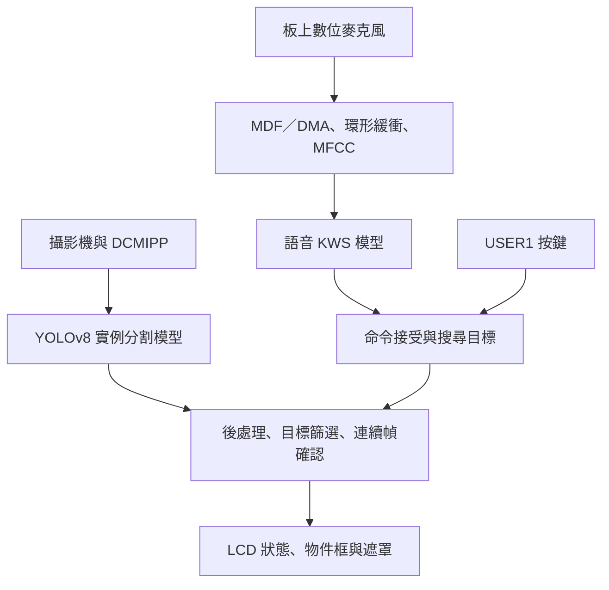

# STM32N6 雙模型語音找物系統

[繁體中文](README.md) | [English](README.en.md)

**技術關鍵字：嵌入式人工智慧（Embedded AI）・C／Python・FreeRTOS 多工作・神經網路加速器（NPU）・Neural-ART・關鍵字辨識（KWS）・YOLOv8 實例分割・INT8 量化・梅爾頻率倒譜係數（MFCC）・CMSIS-DSP・MDF／GPDMA・快取一致性・DCMIPP／LCD・UART／CRC32・GDB・連結腳本（Linker script）・模型記憶體池（Memory pool）・權重與指令分區・工具鏈版本對齊・韌體部署。**

<h1 align="center">實機展示</h1>

<p align="center">
  <a href="https://youtu.be/m7wET9g5u6k">
    
  </a>
</p>

<p align="center">
  <a href="https://youtu.be/m7wET9g5u6k"><strong>▶ 點此觀看完整實機展示影片</strong></a>
</p>

本專案在 **STM32N6570-DK** 上完成語音與視覺協作的嵌入式找物系統，開發範圍從需求定義、板端錄音、資料整理與模型訓練，延伸到雙模型韌體、即時運作及部署除錯。說出杯子（`cup`）、水瓶（`bottle`）或手機（`phone`）的英文名稱，自行訓練的語音模型便選定搜尋目標；持續運作的 YOLOv8 實例分割模型辨識影像，液晶螢幕（LCD）顯示搜尋狀態、物件框與遮罩。USER1 按鍵也能切換目標。

**本案自行建立五分類語音資料集，設計、訓練並量化關鍵字辨識（KWS）模型，完成 YOLOv8 與 KWS 的 N6 產碼及整合部署。** 在模型與硬體之間，將 Python 語音特徵流程移植為 C，建立電腦與板端的逐項數值比對；配置兩模型的 RAM／Flash、權重與執行指令，實作共享神經網路加速器（NPU）的排程、CPU／DMA／NPU 快取交接，以及 FreeRTOS 工作間的影像、目標狀態與顯示資料協作。開發過程也包含現場誤判分析、補充資料與重新訓練，以及啟動、映像封裝和工具鏈相容性問題的定位與修正。

## 本專案完成的工程實作

| 工作範圍 | 具體實作 | 程式與紀錄 |
| --- | --- | --- |
| 語音資料與模型開發 | 建立五分類資料、切段與來源分組；設計深度可分離卷積模型，加入資料增強、資料洩漏檢查、分組五折驗證及 INT8 量化 | [資料整理](kws/prepare_dataset.py)、[定版訓練與量化](kws/training_snapshot/README.md) |
| 板端收音與數值移植 | 建立 RAM 啟動與 UART／CRC32 收音工具；整合連續 MDF／DMA、環形緩衝與防覆寫快照；移植 C 語音前處理並逐項核對 637 個特徵 | [收音工具](kws/recording_tools/README.md)、[連續收音](firmware/Src/finder_mic.c)、[特徵與比對](firmware/Src/finder_kws.c) |
| 視覺模型轉換與部署 | 執行 YOLOv8 的 N6 產碼，配對 Runtime1201，移植後處理介面與建置清單，完成中央裁切、目標篩選、座標映射及遮罩顯示 | [產碼流程](vision/deployment/README.md)、[部署與移植步驟](docs/engineering-workflow.md) |
| 雙模型記憶體配置 | 調整應用 SRAM 邊界、分配 KWS 專用 RAM／Flash，配置視覺指令與後處理區段，核對權重邊界並拆分映像 | [記憶體配置與部署](docs/memory-deployment.md)、[連結腳本](firmware/Gcc/STM32N657xx.ld) |
| 即時系統與應用狀態 | 兩模型依序共用 NPU；修正相機中斷號誌，處理快取一致性；以目標世代、遮罩快照及語音接受狀態機協調推論與顯示 | [整合應用](firmware/Src/app.c)、[系統架構](docs/architecture.md) |
| 問題定位與工程交付 | 以固定特徵、固定音訊及即時視窗分層比對；依現場結果迭代資料與模型；對齊產碼／執行期版本並修正封裝偏移，完成建置與板端部署 | [除錯與迭代歷程](docs/original-history-review.md)、[工具鏈與封裝修正](docs/toolchain-compatibility.md) |

**已保存結果：**五折 INT8 開發驗證 **224/227（98.68%）**；定版模型在 16 段保留音訊的浮點與 INT8 評估皆為 **15/16（93.75%）**；定版板端操作的六次語音命令 **6/6 正確接受**。早期固定五類與四例即時音訊另完成板端／電腦數值對照；這些比較與語音接受紀錄各有版本及測試範圍。[結果與版本範圍](docs/results.md)

## 工程重點：雙模型記憶體配置與部署

**兩個模型的共存，涉及應用連結位址、模型工作區、權重與執行指令的共同配置。** 本案重新配置主應用與 YOLO 的記憶體邊界，再切出 KWS 專用區域；同時處理 CPU／DMA／NPU 快取與資料生命週期。

| 執行時用途 | 位置與保留容量 | 已保存的配置結果 |
| --- | --- | --- |
| 主應用、FreeRTOS、驅動與兩模型 CPU 控制程式 | 內部 SRAM，`0x34000400` 起，**1,023 KiB** | 定版連結用量 **535,544 B**；區域結束於 `0x34100000`，避開視覺模型工作區 |
| YOLO 活化值與輸入輸出 | 模型池中的內部 SRAM／NPU RAM，以及 `0x90000000` 起的外部 RAM 池 | 由視覺模型產碼配置；與應用連結器統計分開追蹤 |
| 相機、LCD、後處理與遮罩快照 | 外部 PSRAM，`0x91000000` 起，**15.75 MiB** | 連結區段用量 **8,949,920 B**；尾端止於 KWS 專區 |
| KWS 活化值與輸入輸出 | 外部 PSRAM，`0x91FC0000` 起，**256 KiB** | 模型產碼配置 **17,440 B**，採絕對位址使用 |

| 非揮發儲存內容 | 外部 Flash 位置 | 配置用途 |
| --- | --- | --- |
| 主應用開機映像 | `0x70100000` | 儲存封裝映像；應用的連結執行位置是上表內部 SRAM |
| YOLO 權重 | `0x70380000` | 與 KWS 權重依實際映像邊界核對；已記錄視覺權重為 **3,474,865 B** |
| KWS 權重 | `0x70700000`，保留 **64 KiB** | 模型產碼配置 **11,409 B** |
| YOLO 執行階段控制器指令（EC blob） | `0x71380000`，保留 **2 MiB** | 獨立指令區段用量 **230,528 B** |

**實際完成的配置工作：**應用 SRAM 由 1,535 KiB 調整為 1,023 KiB；16 MiB PSRAM 尾端切出 256 KiB 給 KWS；視覺指令與應用從同一 ELF 分開輸出，避免跨位址空洞使映像膨脹。KWS 控制程式連入主應用，沒有另外一份 KWS EC blob。

保留容量、連結器用量與模型產碼配置量各有不同意義。KWS 區域在連結器顯示 0 B，是因為產碼採絕對位址配置。視覺上游 Flash 模型池的容量也不等於權重實際長度；本版依已記錄產物邊界核對與 KWS 的間隔，重新產碼時仍須核對。**[完整位址配置、分配責任與映像邊界](docs/memory-deployment.md)**列出細節與原始依據。

## 完整開發路線：32 步

從需求與視覺部署開始，建立語音資料與模型，再完成即時協作、數值除錯、現場迭代及交付。以下 32 步直接列出實作與程式入口；點選步驟名稱可查看該步的問題、做法、產物及結果。

| 階段 | 步驟 | 工作成果 |
| --- | --- | --- |
| [需求與工程版本](#route-foundation) | 01–02 | 定義操作行為，建立正式工程與版本追溯 |
| [視覺模型與尋物功能](#route-vision) | 03–11 | YOLO N6 產碼、執行期配對、相機與後處理、畫面及記憶體整合 |
| [語音資料與 KWS 開發](#route-kws) | 12–17 | 錄音、分組、特徵、模型訓練、INT8 量化及第二模型產碼 |
| [連續收音與雙模型協作](#route-runtime) | 18–21 | 循環 DMA、C 前處理、快取及共享 NPU／跨工作狀態 |
| [部署除錯與現場改善](#route-debugging) | 22–25 | 封裝對齊、分層數值比對、誤判定位與語音接受規則 |
| [定版訓練與板端部署](#route-finalization) | 26–30 | 擴充現場資料、分組五折、保留評估、產物同步與語音操作 |
| [工程交付與實機展示](#route-delivery) | 31–32 | IDE 同步、Git／公開整理與展示影片 |

<a id="route-foundation"></a>

### 01–02｜需求與工程版本

| 步驟 | 完成內容 | 直接程式、設定或紀錄 |
| --- | --- | --- |
| [01 定義功能與操作](docs/development-steps.md#step-01) | 語音指定 cup、bottle、phone；視覺持續尋物、LCD 顯示狀態與遮罩，USER1 提供手動切換。 | [目標選擇與操作邏輯](firmware/Src/app.c) |
| [02 建立正式專案並固定版本](docs/development-steps.md#step-02) | 組織正式韌體、視覺參考與 KWS 開發目錄，固定模型、來源提交與工具版本，保存追溯資料。 | [建立視覺工程原碼](tools/development-history/vision_01_prepare_vision.sh)、[來源版本](docs/source-provenance.json)、[模型紀錄](sources.txt)、[建置入口](firmware/Makefile) |

<a id="route-vision"></a>

### 03–11｜視覺模型與尋物功能

| 步驟 | 完成內容 | 直接程式、設定或紀錄 |
| --- | --- | --- |
| [03 執行 YOLO 模型轉換與 N6 產碼](docs/development-steps.md#step-03) | 在本案執行 ST Edge AI 4.0.1 產碼，產生 N6 網路、STAI 介面、權重及執行指令，完成參考工程建置。 | [本案產碼與建置原碼](tools/development-history/vision_03_generate_and_build_vision.sh)、[產碼參考腳本](vision/deployment/upstream-reference/generate-n6-model_STM32N6570-DK.sh)、[Neural-ART 設定](vision/deployment/upstream-reference/user_neuralart_STM32N6570-DK.json) |
| [04 配對模型執行期](docs/development-steps.md#step-04) | 將視覺參考的 Runtime1200 與正式底座的 Runtime1100 統一至 Runtime1201，同步標頭、函式庫與 NPU 支援來源。 | [參考執行期配對](tools/development-history/vision_02_match_vision_runtime.py)、[正式執行期配對](tools/development-history/vision_06_match_main_runtime.py)、[執行期連結設定](firmware/mks/ai.mk)、[版本差異與修正](docs/toolchain-compatibility.md) |
| [05 將手部模型工程改為 YOLO](docs/development-steps.md#step-05) | 替換原模型產碼與編譯清單，接入 YOLO 網路上下文、輸入輸出及啟動介面。 | [六項產物移植](tools/development-history/vision_05_copy_vision_artifacts.sh)、[模型建置替換](tools/development-history/vision_07_update_model_build_list.py)、[模型建置清單](firmware/mks/ai.mk)、[模型初始化與推論](firmware/Src/app.c)、[啟動入口](firmware/Src/main.c) |
| [06 配置 DCMIPP 裁切與輸入](docs/development-steps.md#step-06) | 從 LCD 視野取中央正方形，縮放為 256×256 RGB 模型輸入，保留顯示管線。 | [DCMIPP_PipeInitNn](firmware/Src/app_cam.c) |
| [07 移植後處理核心與轉接層](docs/development-steps.md#step-07) | 接入偵測解碼與遮罩生成，設定 80 類、1,344 個候選框及 32 張 64×64 遮罩原型。 | [後處理移植原碼](tools/development-history/vision_08_import_postprocessing.py)、[後處理轉接](firmware/Lib/ai-postprocessing-wrapper/app_postprocess_iseg_yolo_v8_ui.c)、[應用配置](firmware/Inc/app_config.h) |
| [08 實作指定物件與連續幀確認](docs/development-steps.md#step-08) | 篩選目標類別的最高信心結果，連續兩幀且框交併比（IoU）至少 0.30 才判定找到。 | [box_iou／目標篩選](firmware/Src/app.c) |
| [09 整合 LCD 框、遮罩與快照](docs/development-steps.md#step-09) | 將框與遮罩映回顯示座標；分開結果快照與繪圖快照，在鎖外繪製，避免後處理覆寫顯示資料。 | [Display_NetworkOutput／顯示工作](firmware/Src/app.c) |
| [10 修正相機中斷與緩衝交接](docs/development-steps.md#step-10) | 中斷路徑使用專用號誌介面與必要的工作切換；複製模型輸入並完成快取維護後才歸還相機緩衝。 | [應用與中斷介面整合原碼](tools/development-history/vision_12_integrate_vision_application.py)、[相機佇列／nn_thread_fct](firmware/Src/app.c) |
| [11 配置視覺記憶體與映像區段](docs/development-steps.md#step-11) | 調整應用 SRAM 邊界，配置 Flash 指令區與 PSRAM 後處理緩衝，從 ELF 分開輸出應用與視覺指令。 | [裁切與記憶體修改原碼](tools/development-history/vision_13_configure_camera_and_memory.py)、[連結腳本](firmware/Gcc/STM32N657xx.ld)、[區段輸出規則](firmware/Makefile) |

<a id="route-kws"></a>

### 12–17｜語音資料與 KWS 開發

| 步驟 | 完成內容 | 直接程式、設定或紀錄 |
| --- | --- | --- |
| [12 建立五類錄音資料](docs/development-steps.md#step-12) | 收集 47 段五秒錄音：三個命令各 12 段、unknown 8 段、silence 3 段；以 GDB RAM 啟動、UART 與 CRC32 完成板端收音。 | [分類收集](kws/collect_n6.py)、[RAM 啟動](kws/recording_tools/n6_mic_start_and_record.sh)、[接收工具](kws/recording_tools/n6_receive_wav.py) |
| [13 切段並按原始錄音分組](docs/development-steps.md#step-13) | 依短時能量與相鄰發音邊界切成一秒片段，分為 142 段訓練、49 段驗證，同一原始錄音的切片保持同組。 | [speech_regions／extract_word](kws/prepare_dataset.py) |
| [14 建立 Python MFCC 前處理](docs/development-steps.md#step-14) | 實作去平均值、Hann 窗、FFT、Mel、對數、DCT 及標準化，產生 49×13 特徵並匯出係數。 | [features 與係數匯出](kws/training_snapshot/train_kws.py) |
| [15 設計並訓練五分類 KWS](docs/development-steps.md#step-15) | 建立深度可分離卷積網路，加入類別權重、音量／噪音／時間平移增強、選模與訓練紀錄。 | [初版訓練](kws/training_history/20261005_baseline/train_kws.py)、[定版模型設計](kws/training_snapshot/train_kws.py) |
| [16 從 SavedModel 匯出 INT8](docs/development-steps.md#step-16) | 以訓練資料作代表資料校正，匯出 INT8 TFLite，保存尺度、零點、前處理係數並比較浮點與量化結果。 | [export_int8](kws/training_snapshot/train_kws_groupcv.py) |
| [17 產生並連入第二模型](docs/development-steps.md#step-17) | 為 KWS 配置獨立名稱、上下文及 RAM／Flash；完成 ST 內部 ONNX 與 Neural-ART 產碼，定版為 11 個 NPU 硬體階段與 1 個 CPU Softmax 階段。 | [KWS 產碼主機流程](tools/development-history/generate_groupcv_model.py)、[記憶體池](kws/deployment/kws.mpool)、[產碼設定](kws/deployment/kws_neuralart.json)、[KWS 建置](firmware/mks/kws.mk) |

<a id="route-runtime"></a>

### 18–21｜連續收音與雙模型協作

| 步驟 | 完成內容 | 直接程式、設定或紀錄 |
| --- | --- | --- |
| [18 整合連續 MDF／GPDMA 收音](docs/development-steps.md#step-18) | 配置循環 DMA、時脈與存取屬性，以 32,768 點環形緩衝提供最新一秒音訊，處理暖機、跨界與快照覆寫。 | [finder_mic_start／receive_block／finder_mic_take](firmware/Src/finder_mic.c) |
| [19 將前處理移植為 C](docs/development-steps.md#step-19) | 使用 CMSIS-DSP 實作與 Python 對應的特徵流程，處理實數 FFT 的直流／奈奎斯特配置，產生 637 個 INT8 特徵。 | [encode_mfcc](firmware/Src/finder_kws.c)、[前處理係數](firmware/Inc/finder_kws_tables.h) |
| [20 處理 CPU／DMA／NPU 快取](docs/development-steps.md#step-20) | DMA 收樣後維護 CPU 快取；更新模型輸入前處理 NPU／CPU 舊快取，寫入後回寫，搭配對齊與記憶體屏障。 | [音訊快取交接](firmware/Src/finder_mic.c)、[kws_begin_input_update／prepare_input_cache](firmware/Src/finder_kws.c) |
| [21 協調雙模型與跨工作狀態](docs/development-steps.md#step-21) | 同一推論工作依序使用 NPU，顯示與 ISP 工作協作；以目標世代捨棄過期結果，配合遮罩快照維持資料一致性。 | [nn_thread_fct／dp_thread_fct／finder_select_target](firmware/Src/app.c) |

<a id="route-debugging"></a>

### 22–25｜部署除錯與現場改善

| 步驟 | 完成內容 | 直接程式、設定或紀錄 |
| --- | --- | --- |
| [22 排查建置、啟動與映像封裝](docs/development-steps.md#step-22) | 分開核對建置、封裝、寫入與啟動；將有效載荷偏移由 0x240 修正為 0x400，確認程式內容一致。 | [封裝偏移檢查](tools/development-history/inspect_boot_payload.py)、[對齊修正原碼](tools/development-history/realign_and_flash_application.sh)、[建置與映像抽取](firmware/Makefile)、[封裝修正紀錄](docs/original-history-review.md) |
| [23 建立三層數值比對](docs/development-steps.md#step-23) | 固定特徵測推論、固定 PCM 測 C 前處理、即時視窗回傳後電腦重算；早期五類固定案例兩路皆正確，PCM 每段 637 個特徵一致。 | [固定參考匯出](tools/development-history/export_fixed_reference.py)、[即時接收與電腦重算](tools/development-history/compare_live_windows.py)、[finder_kws_compare／即時回傳](firmware/Src/finder_kws.c)、[固定參考資料](firmware/Inc/finder_kws_compare_data.h) |
| [24 定位現場誤判並補入樣本](docs/development-steps.md#step-24) | 用板端與電腦三路比對定位安靜誤判 phone，回收現場語音與底噪補訓，加入逐窗分數及收音統計追查漏接。 | [現場診斷錄製](tools/development-history/record_voice_diagnostics.py)、[現場補訓](kws/train_kws.py)、[診斷與取樣](firmware/Src/finder_kws.c)、[比較結果](docs/evidence/development-history/live_comparison_20261007.json) |
| [25 設計語音接受規則](docs/development-steps.md#step-25) | 結合音量、分數、分差、連續兩窗、最短間隔與安靜後重新啟用，將分類結果轉為穩定的目標切換事件。 | [finder_voice_poll](firmware/Src/app.c) |

<a id="route-finalization"></a>

### 26–30｜定版訓練與板端部署

| 步驟 | 完成內容 | 直接程式、設定或紀錄 |
| --- | --- | --- |
| [26 擴充現場資料與開發池](docs/development-steps.md#step-26) | 收集 48 段現場音訊，32 段加入訓練、16 段保留；合併既有 142＋49 段及 4 段現場資料，形成 227 段開發池。 | [現場資料收集程式](tools/development-history/collect_live_dataset.py)、[資料載入](kws/training_snapshot/train_kws_groupcv.py)、[48 段清單](docs/evidence/development-history/live_dataset_manifest_20261008.json) |
| [27 防洩漏分組五折與最終訓練](docs/development-steps.md#step-27) | 以 PCM 雜湊合併來源組別、隔離保留資料，每折獨立標準化與校正；五折 INT8 為 224/227，以最佳輪數中位數 66 輪重訓。 | [make_splits／make_training／fit_model](kws/training_snapshot/train_kws_groupcv.py)、[五折報告](docs/evidence/kws-groupcv.json) |
| [28 保留評估與定版產物同步](docs/development-steps.md#step-28) | 浮點與 INT8 在 16 段保留音訊皆為 15/16；同步模型、係數、量化尺度／零點與診斷開關，固定定版版本。 | [定版安裝與建置原碼](tools/development-history/install_build_groupcv.py)、[匯出與評估](kws/training_snapshot/train_kws_groupcv.py)、[量化介面檢查](firmware/Src/finder_kws.c)、[保留報告](docs/evidence/kws-int8-holdout.json) |
| [29 配置五映像並完成定版寫入](docs/development-steps.md#step-29) | 分工 FSBL、應用、視覺權重、KWS 權重與視覺指令，核對位址及雜湊；定版紀錄保存應用與 KWS 權重兩份寫入驗證。 | [定版寫入與驗證原碼](tools/development-history/flash_groupcv.py)、[連結腳本](firmware/Gcc/STM32N657xx.ld)、[定版寫入清單](docs/evidence/development-history/deployment_20261008/flash_manifest.json)、[寫入驗證](docs/evidence/development-history/deployment_20261008/flash_verified.json) |
| [30 完成定版語音操作測試](docs/development-steps.md#step-30) | cup、bottle、phone 各兩次，共 6/6 語音命令正確接受且目標對應；語音接受與視覺找物結果分別記錄。 | [定版操作錄製](tools/development-history/record_voice_groupcv.py)、[接受與目標切換](firmware/Src/app.c)、[板端操作日誌](docs/evidence/development-history/voice_groupcv_20261008.log) |

<a id="route-delivery"></a>

### 31–32｜工程交付與實機展示

| 步驟 | 完成內容 | 直接程式、設定或紀錄 |
| --- | --- | --- |
| [31 整理 IDE、Git 與公開工程](docs/development-steps.md#step-31) | 同步 IDE 來源與建置入口，保存來源版本、提交與雜湊，整理公開原始碼、依賴及授權。 | [IDE 同步工具](tools/ide/sync_cubeide_sources.py)、[編譯入口](firmware/STM32CubeIDE/STM32N6570-DK/cubeide_make.sh)、[來源紀錄](docs/source-provenance.json) |
| [32 完成實機展示影片](docs/development-steps.md#step-32) | 實機影片已完成並置於首頁；獨立供電與冷啟動尚無已核對紀錄，與影片及既有板測分開呈現。 | [實機影片](https://youtu.be/m7wET9g5u6k)、[展示應用](firmware/Src/app.c) |

每步的完整說明見[32 步開發詳解](docs/development-steps.md)；既有[工程流程](docs/engineering-workflow.md)與[實作索引](docs/development-coverage.md)保留各項程式、配置與結果的對照。

## 雙模型產碼、執行期與封裝整合

本案以 ST Edge AI 4.0.1 產碼，統一兩模型使用的執行期、建置區段與映像封裝規則，完成從模型產物到板端應用的部署。以下列出開發時採用的官方版本、原設定與本案修正，包含官方文件與 Makefile 在封裝對齊要求上的具體差異。

| 官方來源與原設定 | 本案的整合處理 | 完成結果 |
| --- | --- | --- |
| ST 實例分割範例 `42f7d645…`：README 基準為 **ST Edge AI 4.0.0**，Makefile 連結 **Runtime1200**；產碼腳本呼叫系統路徑中的 `stedgeai` | 本案使用 **4.0.1** 產碼，配對 **Runtime1201**，同步更新標頭、函式庫與 NPU 支援來源 | 視覺產碼、參考工程連結與正式工程移植完成 |
| ST 手部雙模型範例 `6c313001…`：README 基準為 **3.0.0**，GCC 建置連結 **Runtime1100** | 將正式韌體底座統一至 **Runtime1201**，讓 YOLO 與 KWS 使用匹配的共用執行環境 | 雙模型 GCC 工程成功建置 |
| ST 分割範例的 CubeIDE `ModelZoo` 組態有視覺指令／後處理區段定義，獨立 Makefile 未帶相同設定 | 在正式 Makefile 明確加入 Flash／PSRAM 區段巨集，並分開輸出應用與視覺指令 | 指令與大型後處理緩衝落入預定區域，映像不因位址空洞膨脹 |
| 同版 ST 分割範例 README 要求 CubeProgrammer **2.21 以上加 `--align`**，但 Makefile 的封裝規則未帶對齊選項 | 本案封裝流程補上對齊，確認有效載荷偏移由 **`0x240` 修正為 `0x400`**，且程式內容一致 | 後續定版紀錄確認應用與 KWS 權重寫入驗證成功，板端完成六次正確語音接受與目標對應 |

版本配對屬跨工具版本的移植工作；封裝部分則有同一官方提交中文件與 Makefile 的具體差異。**[官方原始檔、建置指令、修正與成功紀錄](docs/toolchain-compatibility.md)**逐項說明，並保留本案實際採用的 GCC 路徑。

## 系統如何運作



**視覺持續執行，語音負責切換搜尋目標。** KWS 與 YOLO 在同一個推論工作中依序使用 NPU；顯示與影像訊號處理（ISP）由另外兩個 FreeRTOS 工作協作。音訊 DMA 持續收樣，推論工作取出最新的一秒視窗。

## 兩個模型如何部署到 N6

| 項目 | 語音模型 | 視覺模型 |
| --- | --- | --- |
| 模型與產物建立方式 | 本專案設計、訓練並量化的小型深度可分離卷積模型 | 以來源版本固定的 YOLOv8n-seg TFLite 為輸入，在本案產生 N6 網路、介面、權重與執行指令；[輸入來源與實際轉換紀錄](vision/deployment/README.md) |
| 輸入 | 一秒 PCM 經 MFCC，形成 `49×13×1 INT8` | `256×256 RGB UINT8` |
| 輸出 | `cup`、`bottle`、`phone`、`unknown`、`silence` 五類 | `116×1344` 偵測資料與 `64×64×32` 遮罩原型，皆為 INT8 |
| 部署流程 | Keras 訓練／SavedModel → INT8 TFLite → ST Edge AI 內部 ONNX／量化資訊 → Neural-ART 產碼 | 量化 TFLite → 本案執行 ST Edge AI 4.0.1／Neural-ART 產碼 → Runtime1201 配對 → 模型、後處理與建置移植 → 映像配置與部署 |
| 應用整合 | C 特徵前處理、尺度／零點檢查、命令接受與切換目標 | 後處理介面移植、指定類別篩選、連續幀確認與座標映射 |

視覺部署在本案 `vision/` 中執行 `generate-n6-model_STM32N6570-DK.sh`，完成 N6 產碼、參考工程編譯及映像封裝，再將模型程式、STAI 介面、權重與執行指令移入 `firmware/`。模型來源與工具版本固定保存，移植過程完成以下相容性與配置工作：

| 移植項目 | 實際處理 |
| --- | --- |
| 產碼與執行期配對 | 視覺參考工程的執行期由 1200 換成 1201；手部底座由 1100 換成 1201，同步替換標頭、函式庫與 NPU 支援來源，統一連結 `NetworkRuntime1201_CM55_GCC.a` |
| 後處理與模型替換 | 移入 ST 後處理核心及轉接層，改寫模型與後處理編譯清單，選用 YOLOv8 實例分割介面；設定 80 類、1,344 個候選框及 32 張 64×64 遮罩原型 |
| 指令與緩衝區配置 | 將視覺指令的輸入區段 `.flash_blob` 收進 Flash 輸出區段 `.flash_section`；後處理緩衝 `.psram_bss` 收進 PSRAM 的 `.psram_section (NOLOAD)`，應用與視覺指令從 ELF 分開輸出 |

這條移植流程及各階段成功回報整理於[原始開發歷程](docs/original-history-review.md)，涵蓋模型產碼、參考工程建置、正式韌體移植及板端運作。

KWS 的[原始編譯紀錄](docs/evidence/development-history/codegen_20261008/codegen.log)保存工具內部 ONNX 轉換與 Neural-ART 呼叫。定版配置包含 **11 個 NPU 硬體執行階段與 1 個 CPU Softmax 階段**，權重配置 **11,409 位元組**、活化值配置 **17,440 位元組**；未產生獨立的 KWS 執行階段控制器指令包（EC blob）。

兩個模型各有網路介面與上下文，共用初始化一次的推論執行環境。視覺模型版本與來源固定在 [sources.txt](sources.txt)，KWS 版本則由[模型雜湊與產碼設定](kws/deployment/README.md)追溯。

## 收音資料流程與連續音訊輸入

資料蒐集子系統建立板上數位麥克風到電腦資料集的完整路徑：啟用開發板串列功能（BSP COM）與 HAL UART，將兩個 UART 驅動來源加入 IDE 連結，經多功能數位濾波器（MDF）取得音訊。以 MDF 錄音範例的周邊設定為基礎，加入區塊數、最小值、最大值及峰對峰值監測，再實作獨立五秒錄音與傳輸流程。

錄音採用「先在 RAM 收滿五秒，再傳回電腦」：DMA 半滿／全滿回呼略過暖機區塊並複製樣本，主迴圈處理逾時、錯誤、錄音長度及 CRC32。

主機工具核對映像大小、初始堆疊與入口向量，透過 GDB 載入 RAM、設定核心狀態，並以 `main`／`MicLine` 中斷點確認啟動；接收端處理串列獨占、非阻塞讀取、期限、交握、完整長度、結尾與 CRC32，確認完整後保存 WAV。分類收集工具支援中止後接續，並保留來源與工作階段資訊。

整合到雙模型後，收音改為持續運作：

- **共享時脈與權限**：保留既有 PLL2，只設定麥克風的 IC8 分頻；配置 PE2／PE8、MDF 與 DMA 存取屬性。
- **DMA 與快取**：循環鏈結描述節點與樣本緩衝分別對齊 64／32 位元組；回呼完成快取處理後，用記憶體屏障發布環形緩衝位置。
- **滑動視窗一致性**：名目 16 kHz、32,768 點環形緩衝、每窗 16,000 點；累積至少 3,200 個新樣本才可取窗（名目約 200 ms），實際間隔受 DMA 區塊與工作排程影響；處理環形跨界，若複製過程延遲到資料可能被覆寫，就捨棄該次快照。

程式：[獨立錄音來源與上游差異](kws/recording_firmware/README.md) · [RAM 啟動與接收工具](kws/recording_tools/README.md) · [連續收音模組](firmware/Src/finder_mic.c)

## 資料工程與 KWS 訓練演進

建立 `cup`、`bottle`、`phone`、`unknown`、`silence` 五分類資料。以短時能量切出發音、限制相鄰單字邊界並補成一秒；先依原始錄音分組，再切片，讓同一來源的相近片段保持在同一分組。

初版收集 47 段五秒錄音，整理成 142 段訓練、49 段驗證片段；錄音數與切段數分開計算。訓練從初版離線驗證，經現場資料補訓，演進到分組交叉驗證定版。[訓練歷程](kws/training_history/README.md)按版本整理各版程式、訓練輸出與評估狀態。

- **特徵與網路**：49×13×1 MFCC 輸入、深度可分離卷積網路、類別權重與 INT8 匯出。
- **現場資料改進**：補充板上語音及底噪；加入增益、噪音和時間平移，依發音邊界限制平移幅度，避免增強時截掉單字。
- **資料洩漏防護**：以 PCM 雜湊識別相同內容並合併來源組別，拒絕標籤矛盾及開發／保留資料重複；每折的標準化與背景噪音只來自訓練組。
- **可追溯評估**：檢查每折類別覆蓋與組別不交疊，五折選輪後以 66 輪完成最終訓練；現場收集清單另保存 48 段音訊的用途與雜湊，其中 32 段供訓練、16 段保留。

程式：[切段與分組](kws/prepare_dataset.py) · [MFCC 與模型](kws/training_snapshot/train_kws.py) · [分組驗證與量化](kws/training_snapshot/train_kws_groupcv.py) · [版本演進](kws/training_history/README.md)

## Python／C 數值對照與問題定位

板端用 CMSIS-DSP 浮點 FFT，接續 Mel 濾波、對數及 DCT，再標準化、截限並量化成 INT8。移植時處理實數 FFT 的直流／奈奎斯特儲存位置，並在編譯及初始化階段檢查形狀、型別、尺度與零點。FFT 與特徵工作區採靜態配置，由單一推論工作使用。

除錯分三層：**固定 INT8 輸入測模型 → 同一 PCM 測完整 C 前處理 → 回傳即時 PCM、特徵與輸出，在電腦重算。**

快取交接依實際運算位置處理：更新 KWS 輸入前，先回寫並使 NPU 舊快取失效；CPU 寫入特徵後，再回寫 CPU 快取。最後的機率轉換（Softmax）由 CPU 執行，因此直接讀取 CPU 輸出。這些是移植時的快取維護與排查工作；以下數值比對另外確認輸入、前處理與推論輸出的對應關係。

| 2026-10-07 比較 | 實際結果與用途 |
| --- | --- |
| 五類固定樣本，分別走直接特徵（INPUT）與原始音訊（PCM）兩條路徑 | 五類各一段，共十列比較，預測均與電腦一致；PCM 路徑每段 637 個 INT8 特徵逐項一致。兩路皆有四類輸出差異為 0，silence 最大差異為 1 個量化整數單位 |
| 四個即時視窗回傳至電腦重算 | silence、cup、bottle、phone 的 INT8 特徵差異皆為 0；輸出最大整數差異依序為 0、0、3、1 |

五類各一個固定樣本分別驗證兩條路徑，用來檢查模型部署與前處理一致性；定版分類表現則由前述分組驗證與保留音訊評估。各次比較的版本與方法見[比較過程](docs/original-history-review.md)。

其中一個安靜視窗在板端、電腦直接特徵輸入及電腦完整前處理三路都被判為 `phone`。這個比對把當次問題定位到模型／資料表現，支持後續現場資料迭代；失敗案例與後來定版結果分開保存。

早期離線驗證即有 48/49，但補入四段現場聲音後，一輪帶標籤的六次口令仍只接受兩次。因此再加入逐窗分數、分差、命中數及削波統計，擴充現場資料並採分組五折選輪，最後完成前述定版保留測試與板端 6/6 語音接受紀錄。

程式：[前處理、推論與比較工具](firmware/Src/finder_kws.c) · [前處理係數](firmware/Inc/finder_kws_tables.h) · [原始比較與結果](docs/results.md)

## FreeRTOS 多工作與共享資源整合

在 Cortex-M55 上，推論、顯示與影像訊號處理（ISP）三個工作協作。**視覺持續執行；語音切換搜尋目標。KWS 與 YOLO 在同一推論工作中依序使用 NPU。**

| 工程問題 | 程式中的處理方式 |
| --- | --- |
| 相機回呼在中斷中取得空閒緩衝 | 區分中斷與工作情境，中斷路徑使用 `xSemaphoreTakeFromISR` 與 `portYIELD_FROM_ISR`，工作路徑保留一般號誌介面 |
| 相機擷取與推論共用資料 | 將相機緩衝複製至模型輸入、完成快取維護後才歸還，分開擷取與推論的資料生命週期 |
| CPU／DMA／NPU 看見不同資料 | DMA 接收後處理 CPU 快取；CPU 寫新模型輸入前處理 NPU 舊快取，寫入完成再清理 CPU 快取，搭配對齊與記憶體屏障 |
| 推論途中切換目標 | 用目標世代編號核對結果，捨棄屬於舊目標的過期推論，重新累積連續命中 |
| 後處理覆寫正在顯示的遮罩 | 模型輸出先複製為結果快照，顯示工作在互斥鎖內再取得繪圖快照，於鎖外繪製 |
| 相機裁切與 LCD 位置不一致 | 從顯示視野取中央正方形作為 256×256 模型輸入，再將框與遮罩映射回 LCD 對應區域 |
| 語音重複接受或不穩定 | 綜合音量、分數、分差、連續兩窗、最短間隔及安靜後重新啟用條件 |
| 物件框短暫跳動 | 篩選指定類別的最高信心結果，連續兩幀且框交併比（IoU）至少 0.30 才顯示找到（FOUND） |
| 語音通路執行期間回傳錯誤 | 停用語音並顯示錯誤，保留視覺及 USER1 手動切換路徑；按鍵具上升緣與 200 ms 去彈跳處理 |

上述實作將連續音訊、兩個模型、搜尋狀態與顯示資料串成協作流程，並明確處理中斷情境、資料所有權與結果有效期。語音錯誤處理的適用範圍與驗證狀態見[系統架構](docs/architecture.md)及[實作索引](docs/development-coverage.md)。

程式：[推論、顯示與狀態機](firmware/Src/app.c) · [相機裁切](firmware/Src/app_cam.c) · [CPU／NPU 快取順序](firmware/Src/finder_kws.c)

## 建置與工程交付

在已具備匹配模型產碼、權重、執行環境與 SDK 的完整專案根目錄，既有建置入口為：

```bash
bash firmware/STM32CubeIDE/STM32N6570-DK/cubeide_make.sh \
  build_finder_ide/Project.elf \
  build_finder_ide/Project.bin \
  build_finder_ide/vision_commands.bin
```

此入口核對 GCC 14.3.1，支援 `GCC_PATH`，並以專案相對路徑呼叫 Makefile。它產生應用 ELF、未封裝應用與獨立視覺指令；映像封裝與寫入依[建置說明](docs/build.md)及[部署配置](docs/memory-deployment.md)處理。

完整交付組合為 **FSBL、主應用、視覺權重、KWS 權重、視覺指令**五份映像。FSBL 依 HEX 內含位址寫入，其餘各有固定位置；保存來源、模型版本與映像雜湊。定版更新紀錄確認應用與 KWS 權重兩份寫入驗證成功，其餘沿用既有內容。

IDE 來源同步工具另處理連結核對、預覽、備份、雜湊競態檢查與原子替換，使來源瀏覽入口對應工程內容。公開庫補入[視覺產碼來源與配置入口](vision/deployment/README.md)，搭配既有 [KWS 產碼配置](kws/deployment/README.md)，讓兩個模型的部署流程都有可追溯入口。

程式：[連結腳本](firmware/Gcc/STM32N657xx.ld) · [Makefile](firmware/Makefile) · [KWS 建置](firmware/mks/kws.mk) · [IDE 同步](tools/ide/README.md) · [部署證據](docs/evidence/development-history/README.md)

## 已有結果與適用範圍

| 項目 | 結果 | 證據與解讀 |
| --- | --- | --- |
| 五折 KWS INT8 開發驗證 | **224/227，98.68%** | [五折報告](docs/evidence/kws-groupcv.json)；用於開發與選輪 |
| 定版保留音訊 | **浮點與 INT8 皆 15/16，93.75%** | [保留報告](docs/evidence/kws-int8-holdout.json)；16 段單窗離線分類結果一致，一例 cup 判為 phone |
| 早期固定樣本部署比較 | **五類在 INPUT／PCM 兩路皆正確；PCM 特徵差異為 0** | [比較歷程](docs/original-history-review.md)；五類各一段，兩路輸出最大差異皆不超過 1 個量化整數單位 |
| 早期即時部署一致性 | **四例 INT8 輸入特徵差異皆為 0** | [比較紀錄](docs/evidence/development-history/live_comparison_20261007.json)；用於定位數值與移植問題 |
| 定版板上語音紀錄 | **6/6 正確接受：cup、bottle、phone 各兩次** | [操作日誌](docs/evidence/development-history/voice_groupcv_20261008.log)；接受後目標與命令一致；後續五次可見目標類別切換，同輪 53 列視覺均為 `found=0` |
| 本案早期視覺整合 | CUP、PHONE 有 `found=1` | [視覺日誌](docs/evidence/development-history/finder_vision_20261004.log)；與定版語音紀錄分屬不同版本 |

[實機展示影片](https://youtu.be/m7wET9g5u6k)已提供；本雙模型版本的獨立供電與冷啟動尚未列為實測通過。[完整結果與版本對照](docs/results.md)

## 文件、建置與來源

- [雙模型記憶體與部署配置](docs/memory-deployment.md)：RAM／Flash 位址、區段、模型池、映像邊界與快取交接。
- [官方工具鏈相容性](docs/toolchain-compatibility.md)：固定官方版本、原始設定、修正方式與成功部署紀錄。
- [從起步到定版的工作與證據對照](docs/development-coverage.md)：本專案需求、資料、模型、整合與部署的實作索引。
- [原始開發歷程](docs/original-history-review.md)：視覺產碼與框架移植、收音啟動、固定樣本比較及除錯迭代的整理。
- [程式導讀](docs/code-tour.md)與[系統架構](docs/architecture.md)：函式、執行流程與配置。
- [工程流程](docs/engineering-workflow.md)與[原始證據](docs/evidence/development-history/README.md)：模型、資料、部署及實測紀錄。
- [建置與外部依賴](docs/build.md)：GCC 14.3.1、ST Edge AI 4.0.1、Neural-ART 1.1.3-275、CubeIDE 2.2.0 及相依項目。
- [公開材料盤點](docs/publication-review.md)與[第三方來源](THIRD_PARTY_NOTICES.md)：保存範圍與授權。

## 模型與平台來源

本案自行建立語音資料集，完成 KWS 網路設計、訓練、量化及板端部署；視覺部分完成 YOLOv8 的 N6 產碼、執行期配對、後處理移植、記憶體與映像配置，以及搜尋應用實作。2026-10-04 的視覺產碼輸入來源固定於 ST 模型版本，檔案雜湊與本案各階段產物交接見[視覺轉換紀錄](vision/deployment/README.md)。韌體以 ST 手部雙模型範例的啟動、FreeRTOS 工作及相機框架為基礎；HAL、BSP、CMSIS-DSP、ST 推論執行期，以及視覺解碼、非極大值抑制（NMS）與遮罩重建保留原來源與授權。各元件的來源版本及本案修改入口見[來源與實作範圍](docs/publication-review.md)。

公開儲存庫提供應用與訓練原始碼、配置、修補及工程證據。模型權重、模型產碼、原始錄音與預建映像未隨庫提供；完整建置須具備[對應依賴](docs/build.md)。
